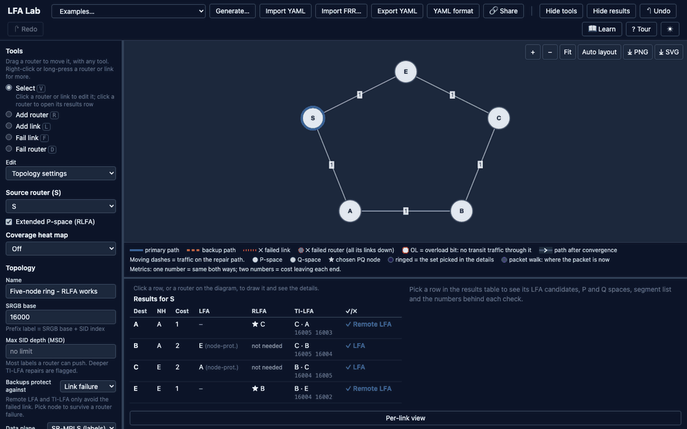
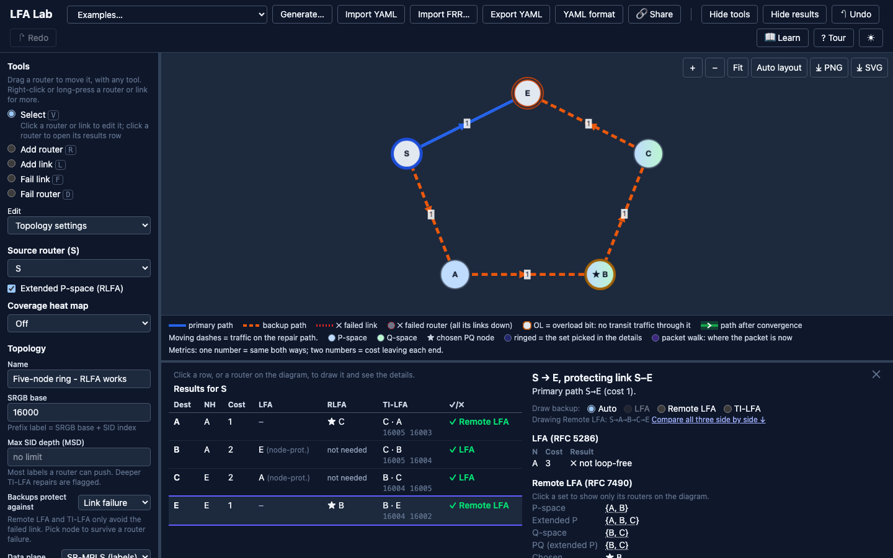
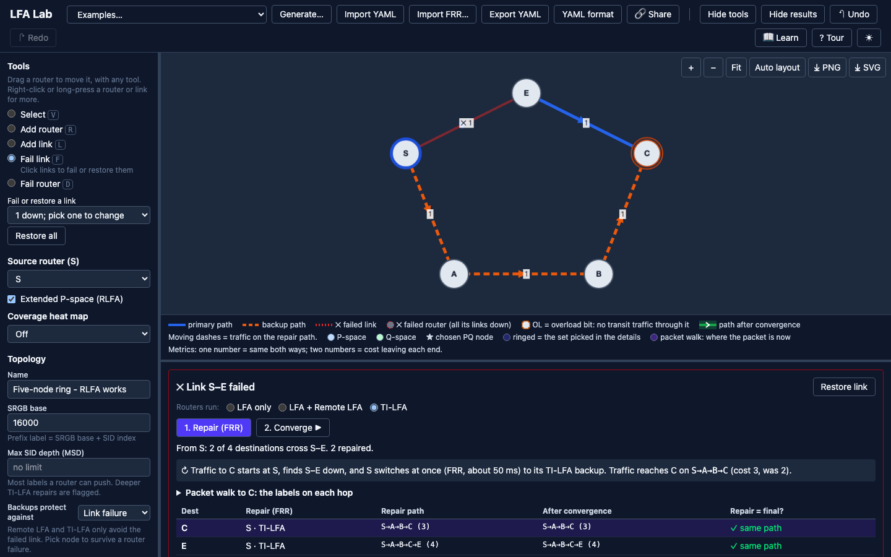
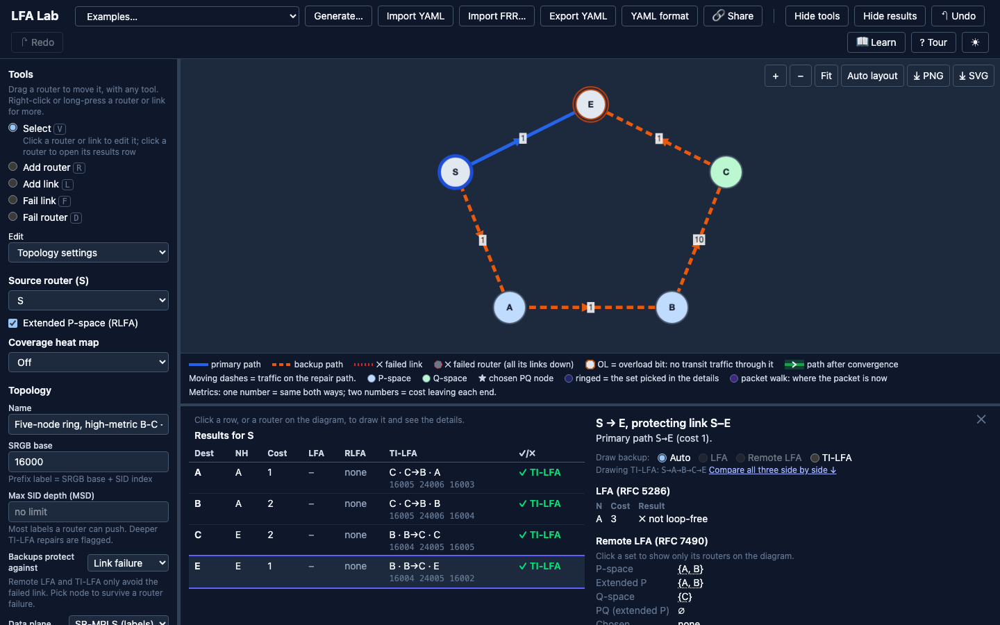
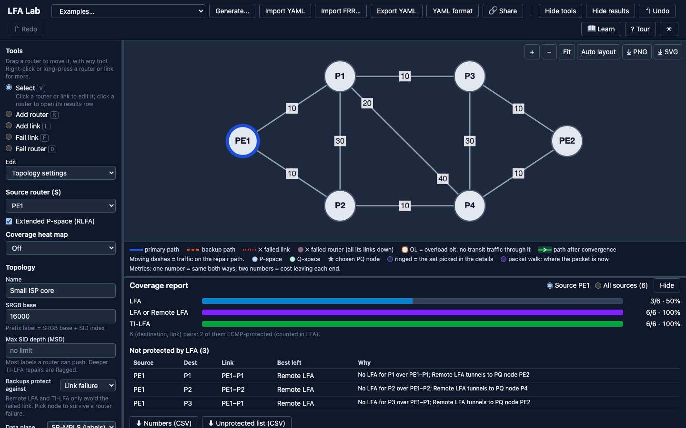
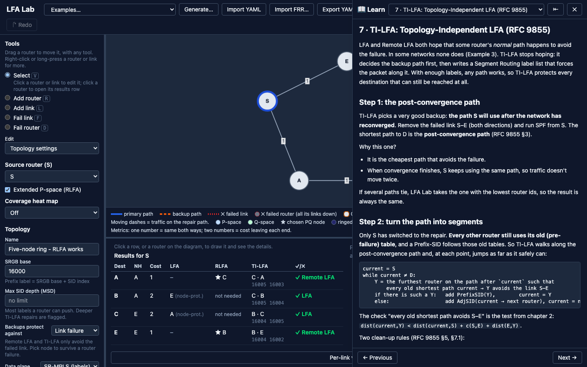
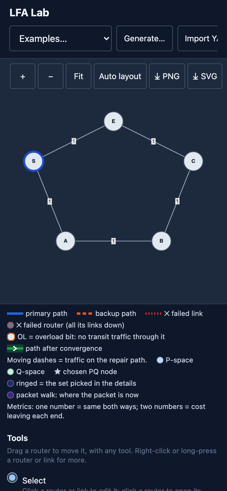

# LFA Lab

A free, open-source browser tool that **computes and shows backup paths for IS-IS networks**: LFA, Remote LFA and TI-LFA. You can also break a link or a router to see where traffic goes.

**Live: [lfa-lab.vercel.app](https://lfa-lab.vercel.app)**. No sign-up, no backend; it works offline after the first visit.



> **Status:** v0.2.0, live (2026-11-02). The MVP, the Phase 9 feedback work, the ideas backlog and the whole "Later (v0.2+)" list are done, plus the Learn guide. See [TODO.md](TODO.md) for what is left.

## The problem
Routers use Fast Reroute (FRR) to switch traffic onto a pre-computed backup path within about 50 ms when a link or node fails. There are three main types:

| Type | Standard | Idea in one line |
|---|---|---|
| **LFA** (Loop-Free Alternate) | RFC 5286 | Send traffic to a neighbor that won't send it back to you. |
| **Remote LFA** (RLFA) | RFC 7490 | No safe neighbor? Tunnel the traffic to a safe router further away (a "PQ node"). |
| **TI-LFA** (Topology-Independent LFA) | RFC 9855 | Use Segment Routing labels to force traffic along the path the network will use *after* it reconverges. Works in almost any topology. |

Learning these is hard: textbooks show one or two static diagrams, and vendor tools are closed and only work on live routers. **No open, interactive tool lets you draw a network and see every backup path with the reasoning behind it.** LFA Lab fills that gap.

## Who it's for
- **Students** (CCNP / JNCIE / university networking courses) learning FRR.
- **Network engineers** checking protection coverage before a design or change.
- **Interview prep** for network software roles.

## What it does
**Build a network**
- Draw routers and links (metrics, one per direction if you want; Prefix-SIDs and Adj-SIDs), with undo / redo, drag, right-click menus and auto layout.
- Or load one: 11 built-in examples, a YAML file, a random generator (ring, grid, leaf-spine, mesh), or FRR `show isis database detail` output.
- Parallel links, LAN links (pseudonodes), IS-IS levels L1 / L2, the overload bit, SRLGs, Flex-Algo and SRv6.
- Share a network as a link (the topology is packed into the URL; nothing is uploaded). Export YAML, PNG or SVG.

**See every backup path**
- Pick a source router (or **All routers**) and get, for each destination: the primary path, LFA, Remote LFA and TI-LFA, with the SR label stack.
- Click a row to draw the paths, P-space, Q-space and the chosen PQ node, and to see **the numbers behind each check**, e.g. `dist(N,D)=10 < dist(N,S)+dist(S,D)=35 ✓`.
- Compare LFA, Remote LFA and TI-LFA side by side; link or node protection; LFA policy knobs (RFC 7916); max SID depth checks.

**Break things**
- Fail one or more links, or a whole router, and watch traffic move to the repair path; then press **Converge** to see the final path and any microloops.
- Packet walk: step through the repair hop by hop with the label stack at each router.

**Check a design**
- Coverage report for one source or all of them ("LFA 50%, TI-LFA 100%"), with the unprotected list and CSV export.
- Coverage heat map on the diagram, per-link view, weakest spots, and a what-if diff when you change a metric.

**Learn**
- **📖 Learn**: a 14-chapter guide from IS-IS basics to TI-LFA, with "Try it" links that set up the app for you, a guided tour and a quiz.

## Screenshots
| | |
|---|---|
|  |  |
| **Remote LFA:** backup path, PQ node and the numbers behind it | **Fail a link:** repair path, then converge |
|  |  |
| **TI-LFA:** the label stack, here with an Adj-SID | **Coverage report** for a source or all sources |
|  |  |
| **Learn guide** beside the diagram | **Phone layout** |

## Run it locally
You need [Node.js](https://nodejs.org) 22 or later.

```sh
git clone https://github.com/danisherrorOrg/frr-lab.git lfa-lab
cd lfa-lab
npm ci
npm run dev        # open the URL it prints (usually http://localhost:5173)
```

Other commands:

| Command | What it does |
|---|---|
| `npm test` | Unit and property tests |
| `npm run lint && npm run typecheck` | Lint, format check and type check |
| `npm run build` | Static build into `dist/` |
| `npm run preview` | Serve the build locally |
| `npm run learn:diagrams` | Redraw the Learn guide's pictures after an engine or example change |

## Learn the protocol
New to Fast Reroute? Start with the **[Learn guide](docs/learn/00-start-here.md)**: IS-IS, SPF, LFA, Remote LFA, Segment Routing and TI-LFA explained from zero, with diagrams, worked examples and exercises to try in the app. In the app, the same guide opens with **📖 Learn**.

## Blog posts
A three-part series on Medium, with pictures and worked numbers from LFA Lab (sources in [docs/blog/](docs/blog/)):

1. [LFA Explained with Pictures](https://medium.com/@danisherror/lfa-explained-with-pictures-b7ba3098ede6): the three LFA inequalities, and why rings break LFA.
2. [Remote LFA Explained with Pictures](https://medium.com/@danisherror/remote-lfa-explained-with-pictures-fd083866aa97): P-space, Q-space and PQ nodes, and where Remote LFA fails.
3. [TI-LFA Explained with Pictures](https://medium.com/@danisherror/ti-lfa-explained-with-pictures-3d6973ced37c): the post-convergence path, Prefix-SIDs and Adj-SIDs, and a packet walk.

## Docs (read in this order)
| File | What's in it |
|---|---|
| [docs/01-requirements.md](docs/01-requirements.md) | Goals, users, features (MVP and later), what we won't build |
| [docs/02-algorithms.md](docs/02-algorithms.md) | Exact maths for SPF, LFA, RLFA and TI-LFA, with 3 worked examples |
| [docs/03-architecture.md](docs/03-architecture.md) | Tech stack, folder layout, data model, YAML format, UI layout |
| [docs/04-roadmap.md](docs/04-roadmap.md) | Phases with checklists (the build order) |
| [docs/05-testing.md](docs/05-testing.md) | Test plan and expected results to check the engine against |
| [docs/learn/](docs/learn/00-start-here.md) | The Learn guide for users: the protocol from zero, with exercises (D60) |
| [docs/blog/](docs/blog/) | Sources and images of the Medium blog posts |
| [TODO.md](TODO.md) | Detailed task list to work through, phase by phase |
| [DECISIONS.md](DECISIONS.md) | Decision log: what was chosen and why |
| [CLAUDE.md](CLAUDE.md) | Rules for AI coding agents working in this repo |
| [examples/](examples/) | Sample topologies used by the docs and the tests |

## Tech stack (short)
TypeScript · React · Vite · Cytoscape.js (graph drawing) · Zustand (state) · Vitest (tests) · deployed as a static site on Vercel, with a small service worker for offline use. **No backend.** Everything runs in the browser.

## Author
Danish Mahajan ([github.com/danisherror](https://github.com/danisherror)). Built from experience implementing IS-IS-SR LFA / RLFA / TI-LFA in router software.
