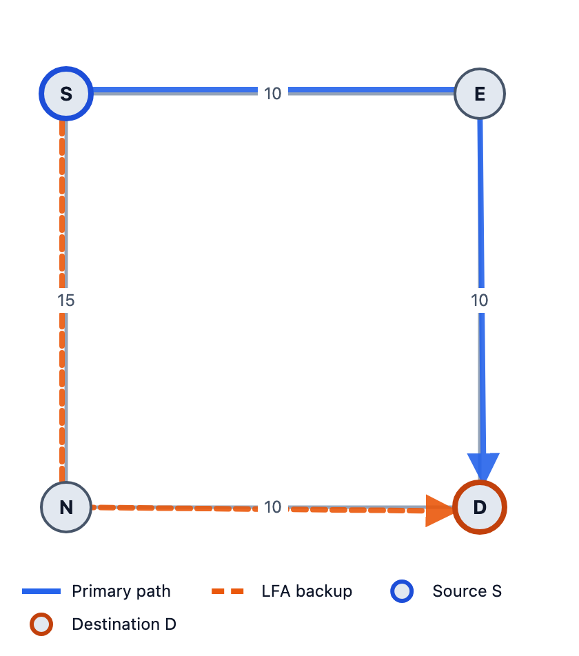
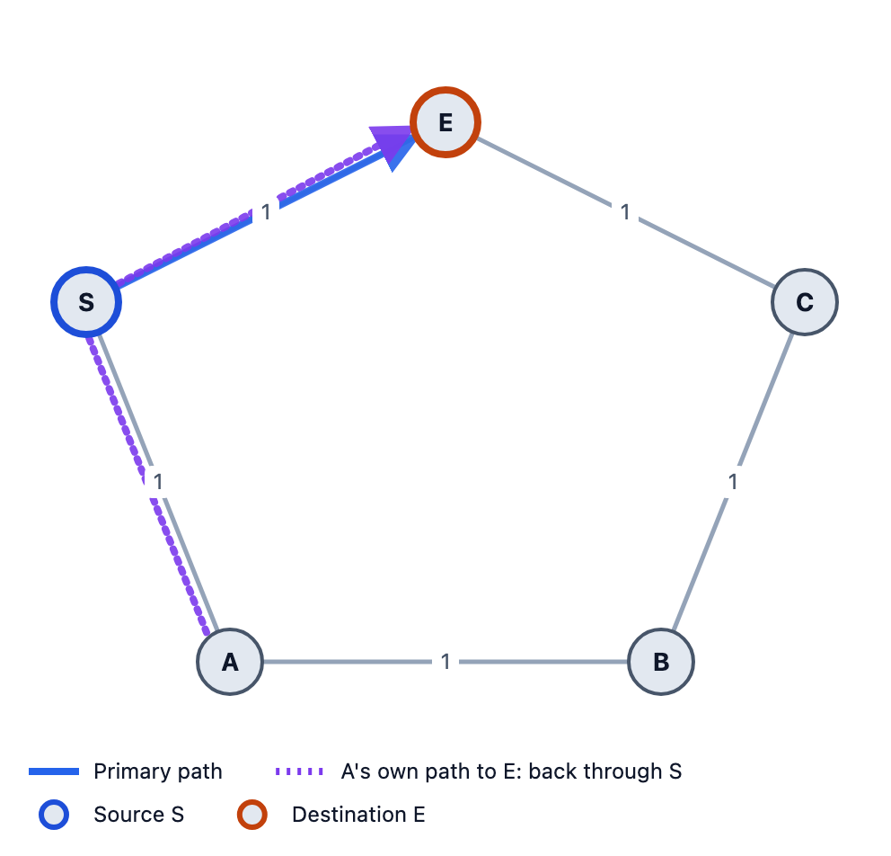

# LFA Explained with Pictures

*Loop-Free Alternates, the simplest kind of IP Fast Reroute: three inequalities, two small networks, and every number worked out.*

---

When a link in an IS-IS network breaks, every router has to learn about it, rerun shortest-path and update its forwarding table. That takes time, often hundreds of milliseconds, and until it's done, traffic sent over the broken link is dropped.

**IP Fast Reroute (FRR)** fixes this by working out a **backup before anything fails**. When the router detects the failure, it switches to the backup straight away, in about 50 ms, without waiting for anyone else. The network then reconverges normally in the background.

The simplest FRR method is the **Loop-Free Alternate (LFA)**, defined in RFC 5286. This post explains it with pictures and real numbers. It's the first of three posts. The next two cover Remote LFA and TI-LFA.

All pictures come from [LFA Lab](https://lfa-lab.vercel.app), a free, open-source browser tool I built that draws these backup paths and shows the math behind them.

---

## The idea in one sentence

When the link to your next hop E fails, **send the traffic to another neighbor N instead**, and let N forward it using its normal routing table.

There's one catch. Only S knows the link has failed. N is still using its old routing table. So the backup only works if **N won't send the traffic straight back to S**.

S has the full map of the network, so it can check this with distances. One piece of notation: `dist(X,Y)` is the cost of X's shortest path to Y.

---

## The square network

Four routers. S sends traffic to D.

- S–E costs 10, E–D costs 10
- S–N costs 15, N–D costs 10

S's shortest path to D is **S → E → D, cost 20**. The other way, S → N → D, costs 25. So E is the primary next hop.

**What happens when link S–E fails?** S's only other neighbor is N. Is N a safe backup?



---

## Inequality 1: loop-free (required)

```
dist(N,D) < dist(N,S) + dist(S,D)
```

The right side is what N's path to D would cost *if it went through S*. If N's real shortest path is strictly cheaper, then N's path doesn't go through S, so N won't send the traffic back.

For the square:

- `dist(N,D) = 10`
- `dist(N,S) + dist(S,D) = 15 + 20 = 35`
- `10 < 35` ✓

**N is a loop-free alternate.** If S–E fails, S sends D's traffic to N, and N sends it straight to D. The backup costs `15 + 10 = 25`.

This is the only check an LFA *must* pass. The next two make it better.

---

## Inequality 2: downstream (stronger)

```
dist(N,D) < dist(S,D)
```

N is **closer to D than S is**. A downstream neighbor can never send traffic back towards S. It also prevents loops when two routers both switch to their backups at the same time.

Square: `10 < 20` ✓. N is downstream.

---

## Inequality 3: node-protecting (strongest)

```
dist(N,D) < dist(N,E) + dist(E,D)
```

N's path to D **doesn't go through router E**. So the backup survives even if the whole router E fails (a crash or a reboot), not just the link.

Square: `dist(N,E) = 20` (via N → D → E), so `10 < 20 + 10 = 30` ✓.

**Result:** N is a node-protecting, downstream LFA, the best kind there is.

---

## A backup that protects the link but not the router

Change the network a little. Now:

- S–E costs 1, E–D costs 1, so S → D goes via E (cost 2)
- S–N costs 1, N–E costs 1
- N–M costs 10, M–D costs 10

Check S's other neighbor, N:

- **Loop-free:** `dist(N,D) = 2 < dist(N,S) + dist(S,D) = 1 + 2 = 3` ✓
- **Downstream:** `2 < dist(S,D) = 2` ✗
- **Node-protecting:** `2 < dist(N,E) + dist(E,D) = 1 + 1 = 2` ✗

N is an LFA, but its shortest path to D is N → E → D, **through E**. If only the link S–E fails, that's fine. If **router E** fails, the backup goes straight into the dead router.

This is why the three inequalities matter. "Has an LFA" doesn't always mean "is protected against every failure".

---

## Where LFA fails: the ring

Now take five routers in a ring: **S – E – C – B – A – S**, every link cost 1. S sends traffic to E over the direct link. Protect link S–E.

S's only other neighbor is A. Check Inequality 1:

- `dist(A,E) = 2`
- `dist(A,S) + dist(S,E) = 1 + 1 = 2`
- `2 < 2` ✗



The picture shows why. A's shortest path to E is A → S → E (cost 2). The long way round, A → B → C → E, costs 3. So if S hands the packet to A, A sends it straight back to S. **No LFA.**

But look at a different destination in the same ring. For **C**:

- `dist(A,C) = 2` (A → B → C)
- `dist(A,S) + dist(S,C) = 1 + 2 = 3`
- `2 < 3` ✓

So A *is* an LFA for C. In the same network, some destinations have an LFA and some don't. Over the whole ring, LFA protects only **50%** of the (destination, link) pairs.

Rings are the classic weak spot of LFA. The neighbor on the "other side" is only loop-free for destinations close to it.

---

## Choosing between several LFAs

When S has several loop-free neighbors, LFA Lab picks one in this order (RFC 5286 §3.2 lists the criteria; the exact order is a local policy):

1. node-protecting before link-protecting only
2. then downstream before not downstream
3. then the lowest backup cost, `c(S,N) + dist(N,D)`
4. then the lowest router id

---

## Why LFA is popular, and why it isn't enough

**Good:** no tunnels, no new labels, no signalling. S just sends to a different neighbor. Every router vendor supports it, and it's cheap to turn on.

**Not enough:** it only works if some neighbor's *existing* shortest path happens to avoid the failure. In rings and many real topologies, that's often not true.

The fix for the ring is the next post: **Remote LFA**. If no neighbor is safe, tunnel the traffic to a safe router further away.

---

## Summary

- **Loop-free:** `dist(N,D) < dist(N,S) + dist(S,D)`. Required.
- **Downstream:** `dist(N,D) < dist(S,D)`. Better.
- **Node-protecting:** `dist(N,D) < dist(N,E) + dist(E,D)`. Best.

| Network | LFA? |
|---|---|
| Square, S → D | ✓ N, node-protecting |
| Link-protecting example | ✓ N, link only |
| Ring, S → E | ✗ A sends it back |
| Ring, S → C | ✓ A |

---

## Try it yourself

Everything above is reproducible in [LFA Lab](https://lfa-lab.vercel.app). It runs in your browser, with no sign-up and no backend.

1. Open the app, click **Examples…** and load **"Square - LFA works"**.
2. Pick source **S** and click the row for destination **D**. The **Explain** section shows the three inequalities with these numbers.
3. Load **"Five-node ring - RLFA works"** and open the row for **E**: no LFA. Then open the row for **C**: A is an LFA.
4. Load **"Link-protecting LFA - breaks when E fails"**, fail router **E** and watch what happens to the backup.

The app also has a 14-chapter **Learn** guide that goes from IS-IS basics to TI-LFA. The code is open source on [GitHub](https://github.com/danisherrorOrg/frr-lab).

**References:** [RFC 5286](https://www.rfc-editor.org/rfc/rfc5286) (LFA), [RFC 6571](https://www.rfc-editor.org/rfc/rfc6571) (LFA applicability), [RFC 7916](https://www.rfc-editor.org/rfc/rfc7916) (LFA policy).
