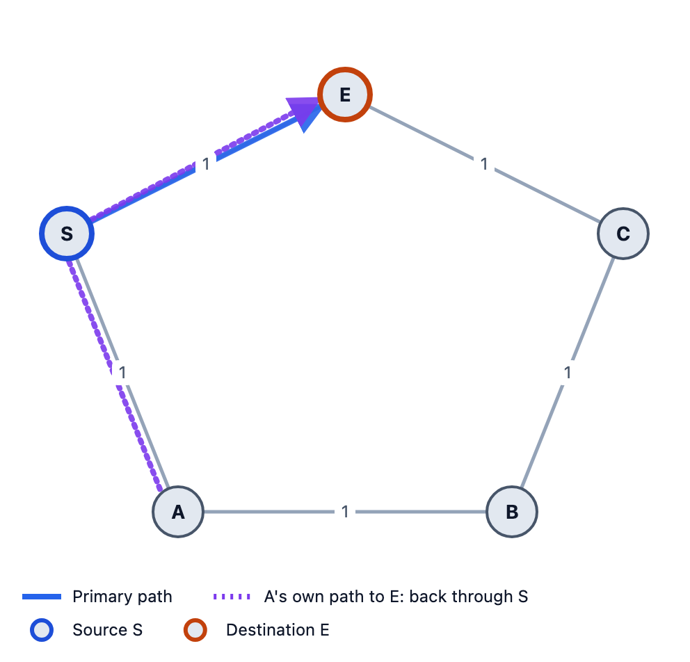
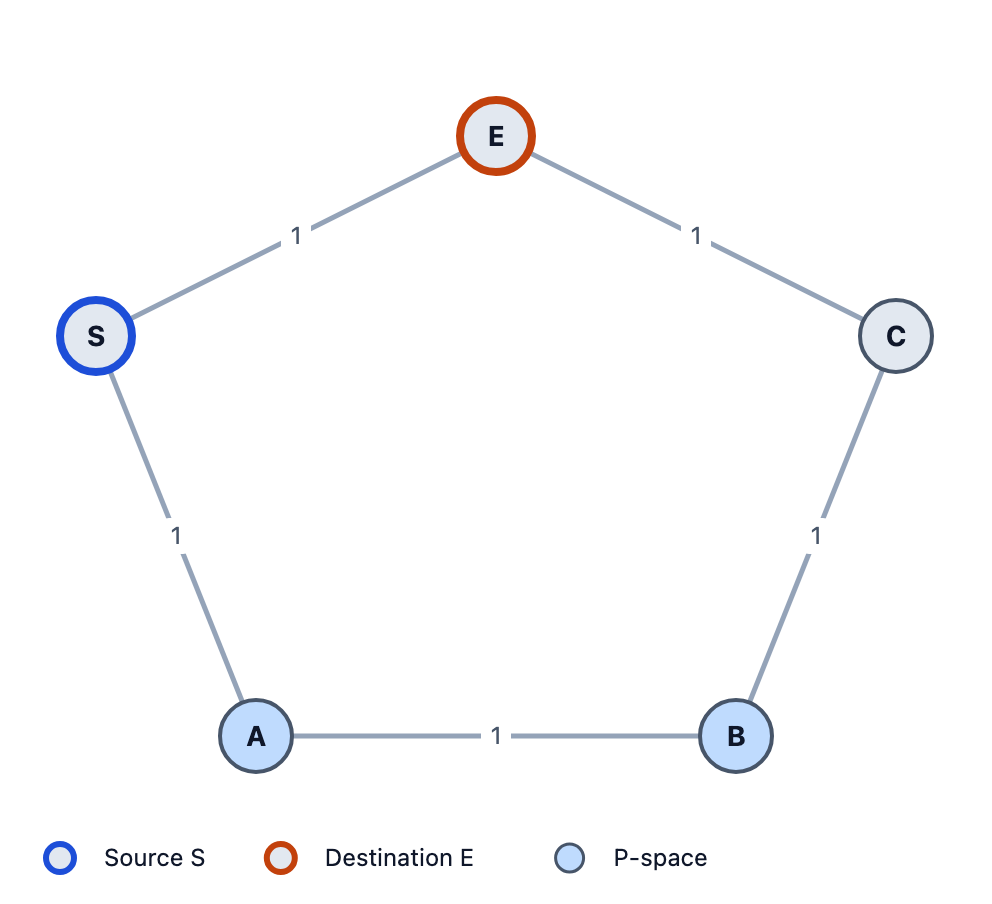
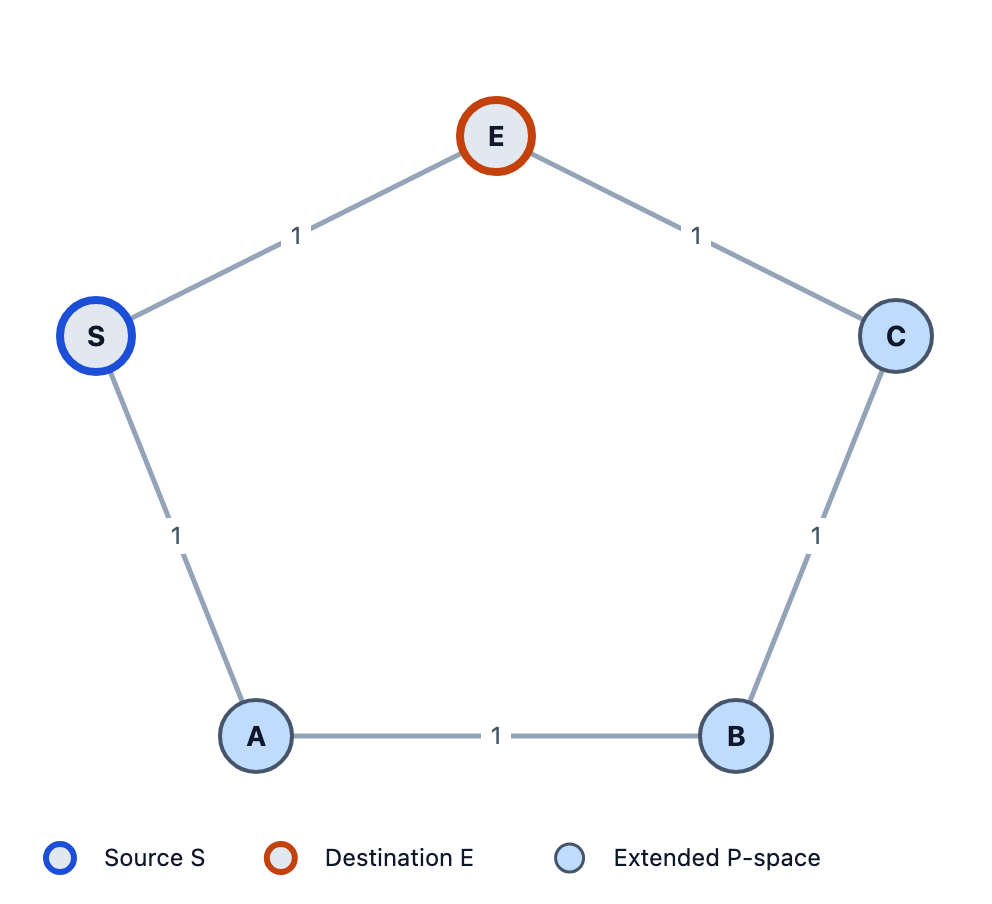
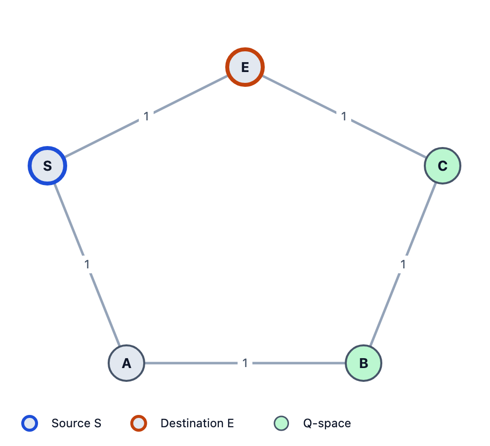
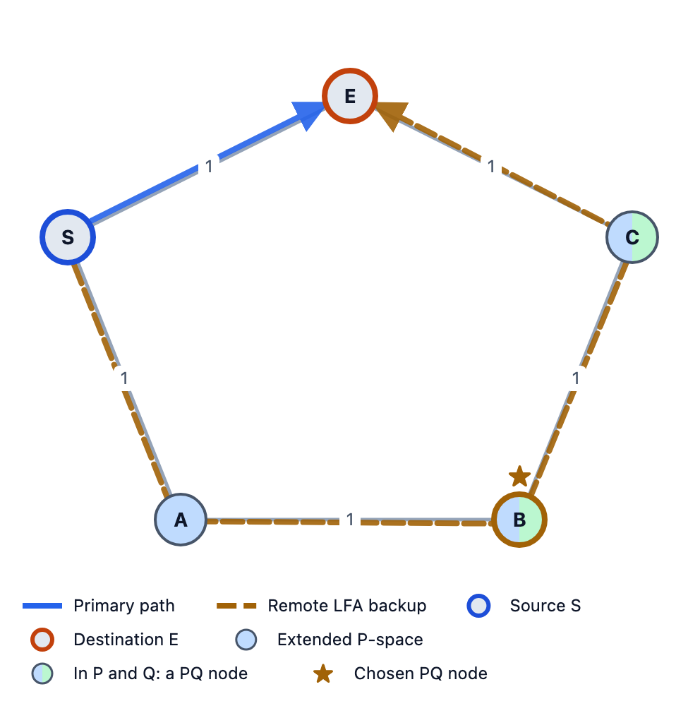
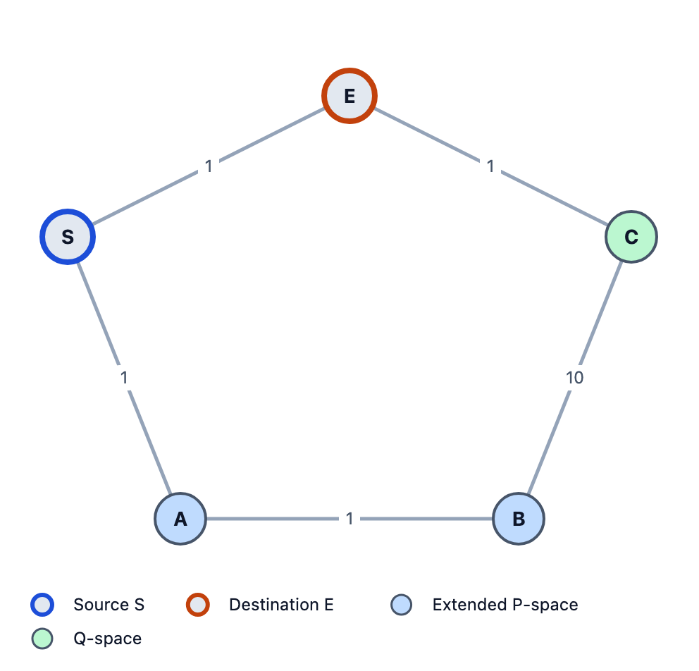
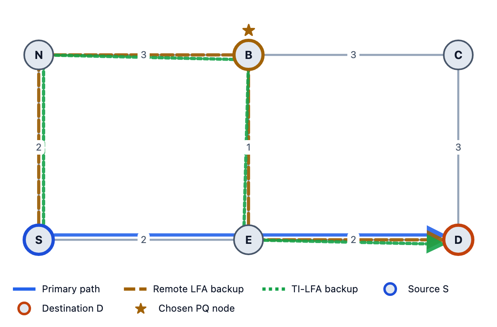
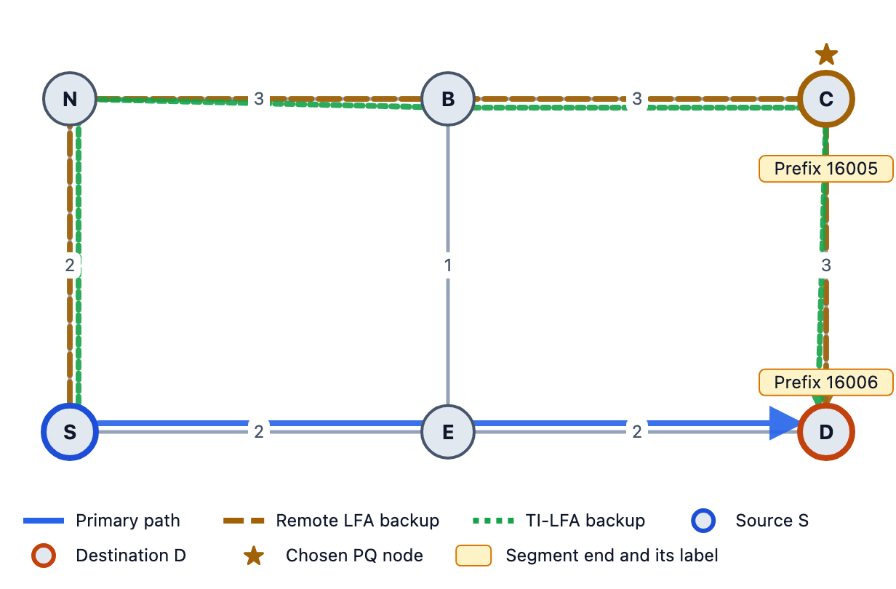

# Remote LFA Explained with Pictures

*When no neighbor is a safe backup, tunnel the traffic to a safe router further away. P-space, Q-space and PQ nodes on a five-router ring, every number worked out.*

---

In the last post we saw **LFA** (RFC 5286): when the link to your next hop fails, send the traffic to another neighbor whose own shortest path avoids the failure. It's simple and cheap, but in some networks no neighbor qualifies.

**Remote LFA** (RFC 7490) fixes that. Its idea: **if no neighbor is safe, find a safe router further away, and tunnel the traffic to it.** The tunnel carries the packet past the neighbor that would have sent it back.

This is the second of three posts. The next one covers TI-LFA.

All pictures come from [LFA Lab](https://lfa-lab.vercel.app), a free, open-source browser tool I built that draws these backup paths and shows the math behind them.

---

## The problem: a ring with no LFA

Five routers in a ring: **S – E – C – B – A – S**. Every link costs 1. S sends traffic to E over the direct link. We protect link S–E.

One piece of notation: `dist(X,Y)` is the cost of X's shortest path to Y.

S's only other neighbor is A. The LFA test:

- `dist(A,E) = 2 < dist(A,S) + dist(S,E) = 1 + 1 = 2` ✗



A's shortest path to E is A → S → E. If S hands the packet to A, A sends it straight back. **No LFA.**

But B is two hops away, and B's shortest path to E is B → C → E. That doesn't touch S–E at all. If S could get the packet to B *without A turning it around*, B would deliver it. That's exactly what a tunnel does.

To find a router like B, Remote LFA computes two sets.

---

## P-space: where S can send traffic safely

The **P-space** of S is the set of routers S reaches on its normal shortest path **without using the link S–E**:

```
Y is in P(S)  if  dist(S,Y) < c(S,E) + dist(E,Y)
```

The right side is the cheapest path from S to Y that *starts* with the link S–E. If S's real shortest path is strictly cheaper, it doesn't use that link.

For the ring:

- **A:** `1 < 1 + 2 = 3` ✓
- **B:** `2 < 1 + 2 = 3` ✓
- **C:** `2 < 1 + 1 = 2` ✗ (it's a tie: S might reach C via E)

**P(S) = {A, B}**



### Extended P-space

S can also send the packet out to a neighbor first and let *that neighbor* forward it normally. So any router a neighbor N reaches without coming back through S is usable too:

```
Y is in P(N)  if  dist(N,Y) < dist(N,S) + dist(S,Y)
```

Via neighbor A, check C:

- `dist(A,C) = 2` (A → B → C)
- `dist(A,S) + dist(S,C) = 1 + 2 = 3`
- `2 < 3` ✓

So C joins. **Extended P-space = {A, B, C}**. The catch: to reach C, S must send the tunnel out through A, because S's own shortest path to C goes over the broken link.



---

## Q-space: who can reach E safely

The **Q-space** of E is the set of routers whose normal shortest path **to E** doesn't use the link S–E:

```
Y is in Q(E)  if  dist(Y,E) < dist(Y,S) + c(S,E)
```

Note the direction: this time it's the distance *from* Y *to* E.

- **A:** `2 < 1 + 1 = 2` ✗ (tie)
- **B:** `2 < 2 + 1 = 3` ✓
- **C:** `1 < 2 + 1 = 3` ✓

**Q(E) = {B, C}**



Once the packet reaches E, E forwards it normally to the final destination. So E's Q-space works for every destination behind E.

---

## PQ nodes: the tunnel endpoint

A **PQ node** is in both sets: S can reach it safely, and it can reach E safely.

**PQ = {A, B, C} ∩ {B, C} = {B, C}**

Which one? RFC 7490 says: the lowest cost from S, then the lowest router id.

- **B** is in S's own P-space. Cost: `dist(S,B) = 2`.
- **C** is only reachable through A. Cost: `c(S,A) + dist(A,C) = 1 + 2 = 3`.

**Chosen PQ node: B.**



The repair: S puts the packet in a tunnel to B (S → A → B). A forwards it towards B, because it's addressed to B now, not E. B takes the packet out of the tunnel and forwards it on its normal path, B → C → E. Total cost 4.

### What is the tunnel?

RFC 7490 allows any tunnel. Classic deployments used an LDP label learned over a targeted LDP session to the PQ node. With **Segment Routing**, the tunnel is just one extra MPLS label: the PQ node's Prefix-SID. In this example, B's Prefix-SID is 16004.

Remote LFA only runs when there's no plain LFA. If a neighbor already works, there's no need for a tunnel.

---

## Where Remote LFA fails

Same ring, but change one number: **link B–C now costs 10**. Everything else stays at 1.

That changes the distances:

- B's best path to E is no longer B → C → E (cost 11). It's B → A → S → E, **cost 3**, over the protected link.
- A's best path to C is A → S → E → C (cost 3), also over the protected link.

Redo the sets:

- **P(S):** A ✓, B ✓, C ✗ → {A, B}
- **Extended via A:** C needs `dist(A,C) = 3 < 1 + 2 = 3` ✗ → still {A, B}
- **Q(E):** A `2 < 2` ✗, B `3 < 2 + 1` ✗, C `1 < 3` ✓ → {C}

**P ∩ Q = {}. No PQ node, so Remote LFA fails.**



P-space ends at B. Q-space starts at C. The only link between them, B–C, costs 10, so no shortest path ever uses it. A single tunnel to one router can't bridge that gap.

This is called the "P and Q are adjacent" case, and it's exactly where TI-LFA comes in. TI-LFA uses a second label, an **Adj-SID**, to force the packet across B–C. That's the next post.

---

## Bonus: node protection (RFC 8102)

Plain Remote LFA protects the **link** S–E. But if **router E** crashes, the PQ node's path might still go through E. RFC 8102 adds two checks for each PQ candidate Y:

1. The tunnel to Y avoids E: `dist(S,Y) < dist(S,E) + dist(E,Y)` (or the same check through a neighbor N).
2. Y's own path to D avoids E: `dist(Y,D) < dist(Y,E) + dist(E,D)`.

Here's a network where it matters. S sends to D via E (cost 4):

- S–E 2, E–D 2, S–N 2, E–B 1, N–B 3, B–C 3, C–D 3

With link protection, the best PQ node is **B** via N (cost 5). But B's path to D is B → E → D, through E. (The green dotted line in these pictures is TI-LFA, from the next post. Ignore it for now.)



Check 2 for B: `dist(B,D) = 3 < dist(B,E) + dist(E,D) = 1 + 2 = 3` ✗. B fails.

For C: the tunnel via N avoids E (`6 < 4 + 4` ✓) and C's path to D avoids E (`3 < 4 + 2` ✓). **The node-protecting PQ node is C.** The repair S → N → B → C → D costs 11 and survives router E failing.



---

## Summary

- **P-space of S:** `dist(S,Y) < c(S,E) + dist(E,Y)`. Where S can go without the link.
- **Extended P-space:** also routers a neighbor N reaches: `dist(N,Y) < dist(N,S) + dist(S,Y)`.
- **Q-space of E:** `dist(Y,E) < dist(Y,S) + c(S,E)`. Who reaches E without the link.
- **PQ node:** in both. Tunnel to it; it forwards normally.

| Ring | P | Q | PQ node | Remote LFA |
|---|---|---|---|---|
| B–C = 1 | {A, B, C} | {B, C} | B | ✓ |
| B–C = 10 | {A, B} | {C} | none | ✗ |

---

## Try it yourself

Everything above is reproducible in [LFA Lab](https://lfa-lab.vercel.app). It runs in your browser, with no sign-up and no backend.

1. Open the app, click **Examples…** and load **"Five-node ring - RLFA works"**.
2. Pick source **S** and click the row for destination **E**. In the detail panel, click the P, Q and PQ sets: they light up on the diagram.
3. Untick **Extended P-space (RLFA)** in the sidebar: C leaves P-space.
4. Load **"Five-node ring, high-metric B-C"**: Q = {C}, no PQ node.
5. Load **"Node protection - avoid the next-hop router"** and open the row for **D**: the PQ node is C.

The app also has a 14-chapter **Learn** guide that goes from IS-IS basics to TI-LFA. The code is open source on [GitHub](https://github.com/danisherrorOrg/frr-lab).

**References:** [RFC 7490](https://www.rfc-editor.org/rfc/rfc7490) (Remote LFA), [RFC 8102](https://www.rfc-editor.org/rfc/rfc8102) (Remote LFA node protection), [RFC 5286](https://www.rfc-editor.org/rfc/rfc5286) (LFA).
