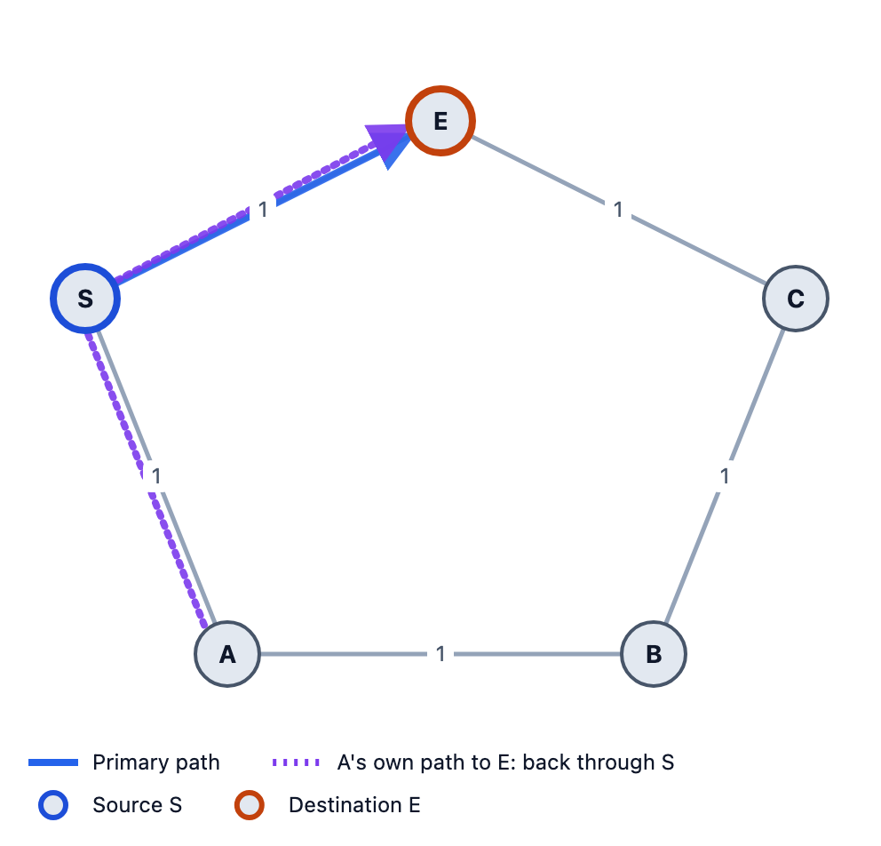
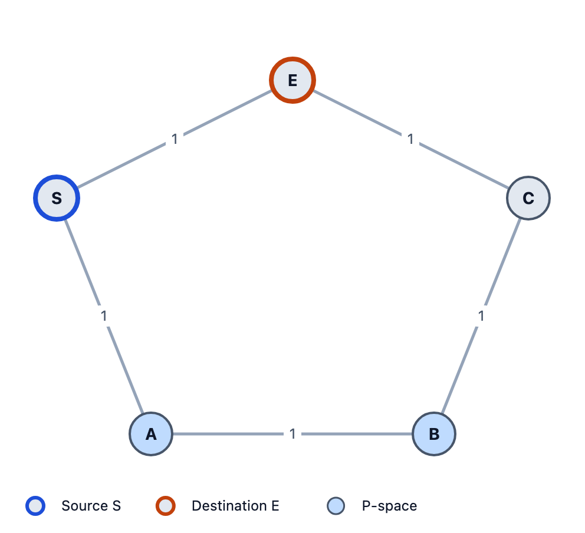
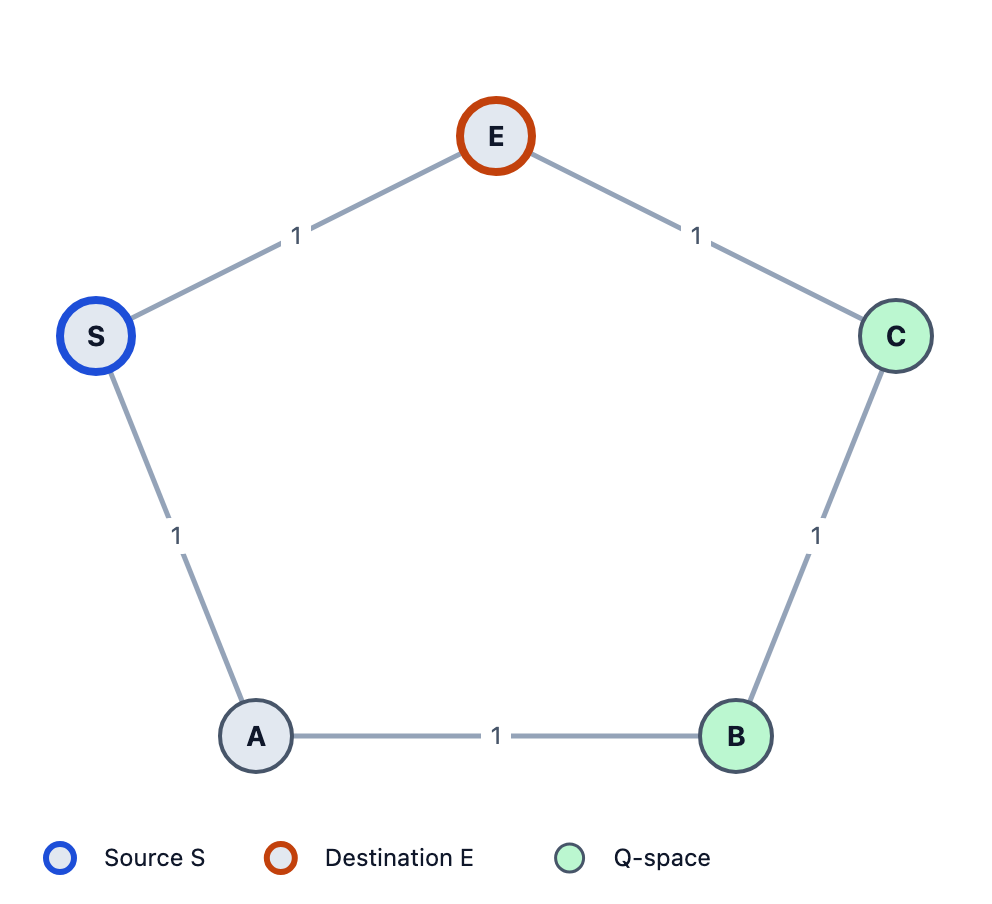
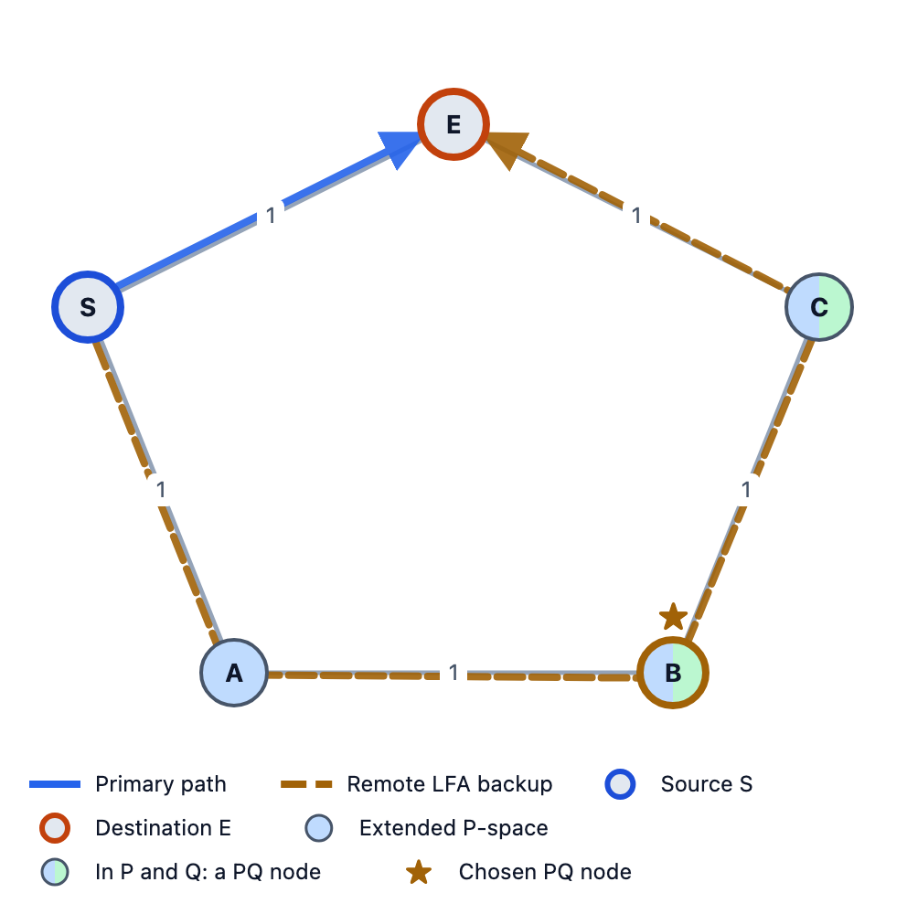
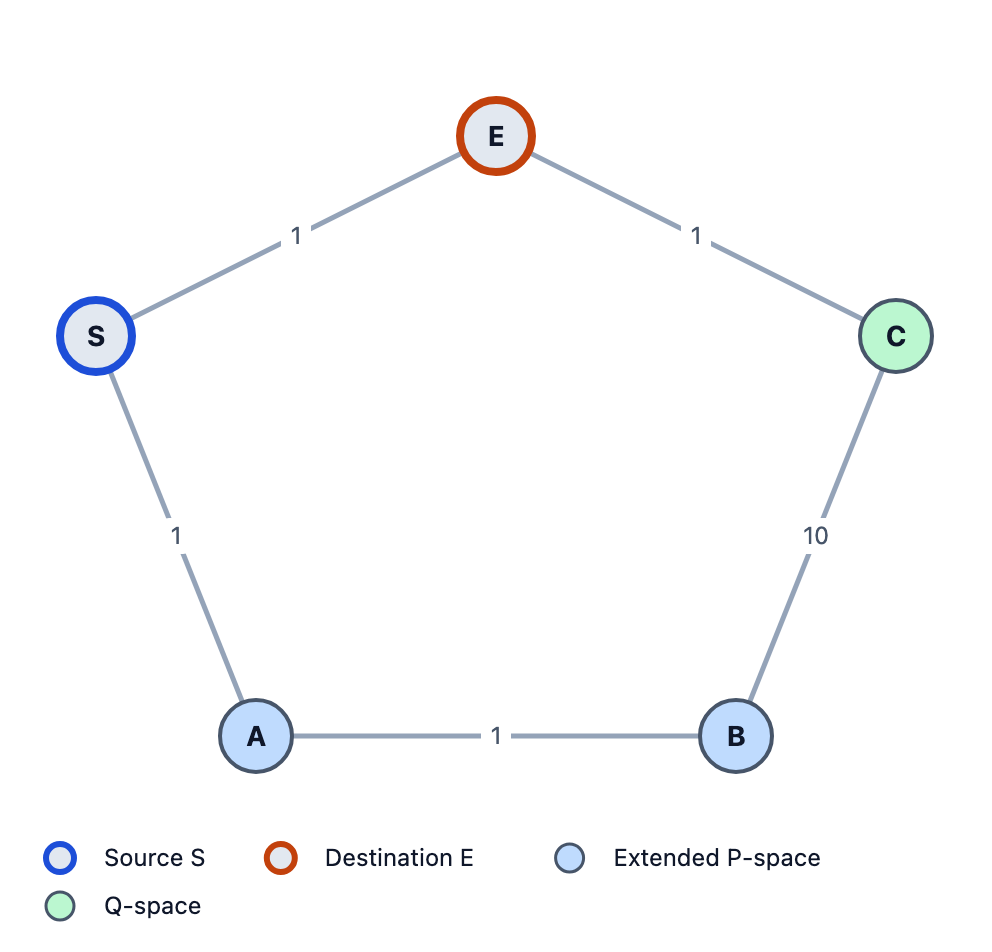
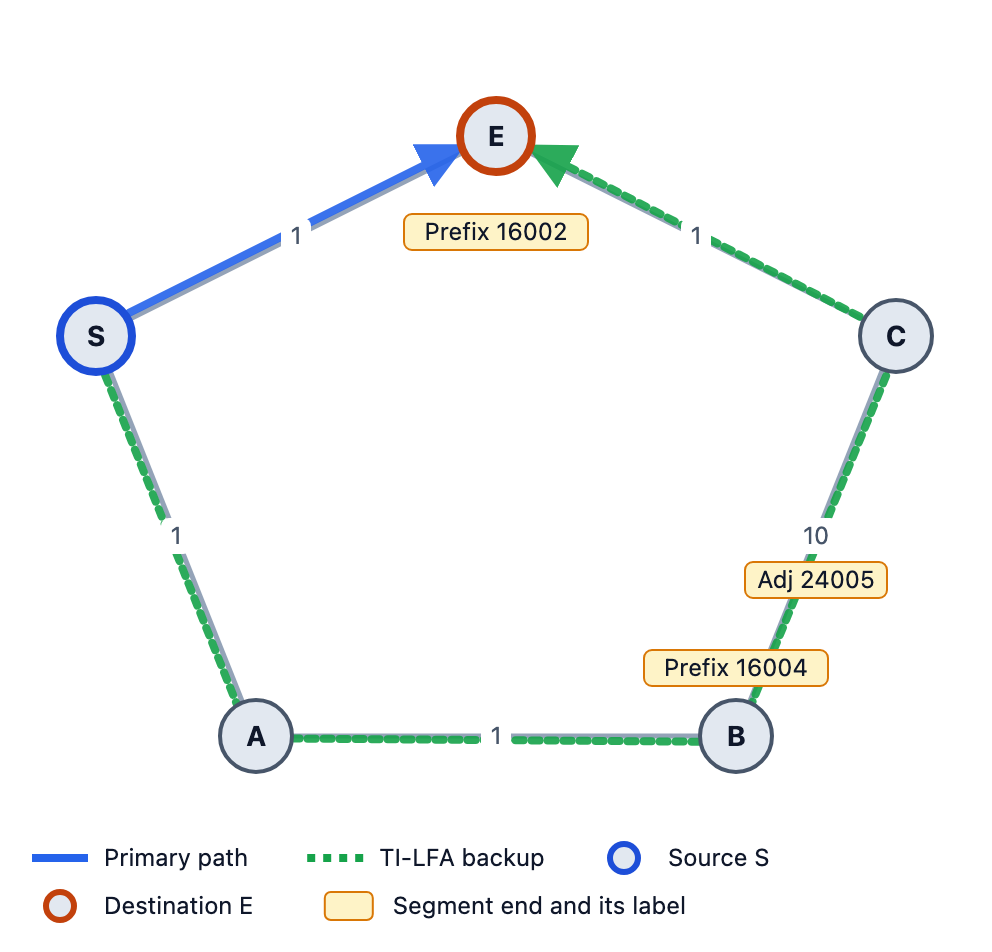
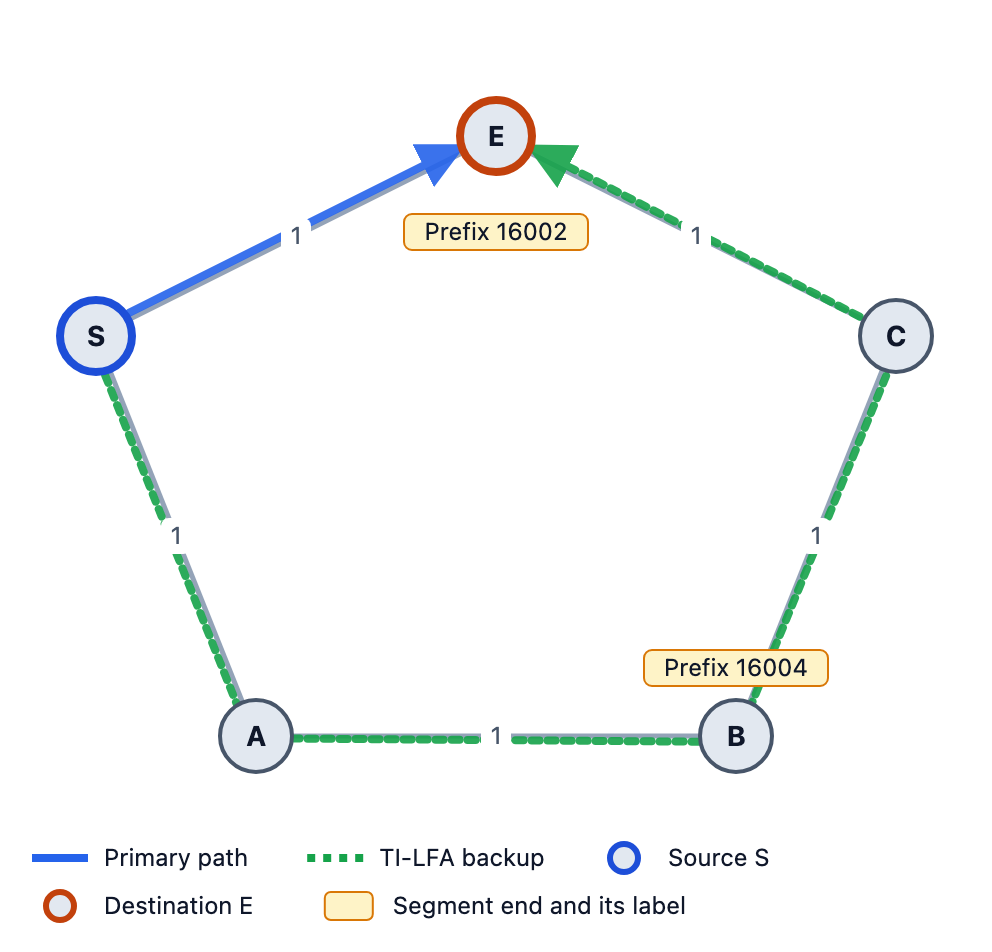

# TI-LFA Explained with Pictures

*How a router gets traffic around a broken link in under 50 ms, even in networks where the classic tricks fail. Five routers, two examples, every number worked out.*

---

When a link in an IS-IS network breaks, the routers eventually agree on new shortest paths. "Eventually" can mean hundreds of milliseconds. Voice calls, video and trading traffic don't like that, so routers pre-compute a **backup path** and switch to it the moment the link goes down. This is **Fast Reroute (FRR)**.

There are three common types:

| Type | Standard | Idea in one line |
|---|---|---|
| **LFA** | RFC 5286 | Send traffic to a neighbor that won't send it back to you. |
| **Remote LFA** | RFC 7490 | No safe neighbor? Tunnel to a safe router further away. |
| **TI-LFA** | RFC 9855 | Use Segment Routing labels to force traffic along the path the network will use *after* it recovers. |

Textbooks usually explain these with one static diagram. I find them much easier with a small network and real numbers, so that's what this post does. We'll use a five-router ring, break one link, and watch LFA fail, then Remote LFA fail, then TI-LFA succeed.

All pictures come from [LFA Lab](https://lfa-lab.vercel.app), a free, open-source browser tool I built that draws these backup paths and shows the math behind them.

---

## The setup

Five routers in a ring: **S – E – C – B – A – S**. Every link costs 1.

- **S** is the router we care about (the source).
- **E** is the destination.
- S's normal path to E is the direct link S–E, cost 1.
- We protect that link: **what happens when S–E breaks?**

One word of notation: `dist(X,Y)` is the cost of X's shortest path to Y.

---

## Step 1: Why plain LFA fails

LFA asks a simple question: *is there a neighbor I can hand the packet to, which won't send it straight back to me?*

S has only one other neighbor: **A**. The LFA rule (RFC 5286) says neighbor N is safe if:

```
dist(N, D) < dist(N, S) + dist(S, D)
```

For A: `dist(A,E) = 2` and `dist(A,S) + dist(S,E) = 1 + 1 = 2`.

**2 < 2 is false.** ✗



The picture shows why. A's own shortest path to E is A → S → E (cost 2); the long way round, A → B → C → E, costs 3. So if S hands the packet to A, A sends it right back to S, which sends it to A… a loop. **No LFA.**

This is common: rings are the classic case where LFA can't help.

---

## Step 2: Remote LFA, a tunnel to a safe router

If no *neighbor* is safe, maybe a router further away is. Remote LFA looks for a router that:

1. **S can reach without using S–E** (the *P-space*), and
2. **can reach E without using S–E** (the *Q-space*).

A router in both is a **PQ node**. S tunnels the packet to it, and from there it travels normally.

### P-space: where S can go safely

Y is in S's P-space if S's shortest path to Y can't go through S–E:

```
dist(S,Y) < dist(S,E) + dist(E,Y)
```

- A: `1 < 1 + 2` ✓
- B: `2 < 1 + 2` ✓
- C: `2 < 1 + 1` ✗ (S's path to C goes through E)

**P = {A, B}**



### Q-space: who can reach E safely

Y is in E's Q-space if Y's shortest path to E can't go through S–E:

```
dist(Y,E) < dist(Y,S) + dist(S,E)
```

- A: `2 < 1 + 1` ✗
- B: `2 < 2 + 1` ✓
- C: `1 < 2 + 1` ✓

**Q = {B, C}**



### The PQ node

P ∩ Q = **{B}**. (With the "extended P-space" from RFC 7490, C qualifies too, but B is closer.) So S wraps the packet in a tunnel to B. B unwraps it and sends it on its normal path, B → C → E.



Remote LFA works here. Now let's break it.

---

## Step 3: Change one number, and Remote LFA fails

Same ring, but the link **B–C now costs 10** instead of 1. Maybe it's a slow or expensive link. Everything else is the same.

That changes the distances:

- `dist(B,E)`: the short way B → C → E now costs 11, so B's best path to E is B → A → S → E, **cost 3**. It goes through S–E.
- `dist(A,C)`: A → B → C costs 11, so A goes A → S → E → C, cost 3.

Redo the sets:

- **P(S)** is still {A, B}.
- **Q(E)**: A `2 < 2` ✗, B `3 < 2 + 1` ✗, C `1 < 3` ✓ → **Q = {C}**.

**P ∩ Q is empty.** No router is both reachable from S and able to reach E without the broken link.



P-space ends at B, Q-space starts at C, and the gap between them is exactly the expensive B–C link. Every normal shortest path that crosses that gap avoids B–C and goes through S–E instead. **Remote LFA has nothing to tunnel to.**

On a real network this is a protection hole: if S–E fails, traffic to E is dropped until the network reconverges.

---

## Step 4: TI-LFA, decide the path first

LFA and Remote LFA both *hope* some router's normal path happens to avoid the failure. TI-LFA stops hoping. It works in two steps.

### 4a. Pick the post-convergence path

Remove link S–E and run shortest-path from S. The result is the path S will use *after* the whole network has recovered: the **post-convergence path**.

In our high-metric ring there's only one way left: **S → A → B → C → E**, cost 1 + 1 + 10 + 1 = **13**.

Why this path? It's the cheapest path that avoids the failure, and since S will use it after convergence anyway, traffic only moves once.

### 4b. Turn the path into labels

Here's the catch: only S knows about the failure. **Every other router still uses its old routing table.** So S can't just say "go to E", because A would send it straight back.

Segment Routing gives S two kinds of labels to push onto the packet:

- **Prefix-SID** of router Y: "go to Y along your *normal* shortest path".
- **Adj-SID** of a link: "send me over *this exact link*", whatever the routing table says.

S walks along the post-convergence path and, from each point, jumps as far as it safely can with a Prefix-SID. If it can't jump at all, it forces the next link with an Adj-SID.

**From S:**
- Can S jump to C? S's normal path to C is S → E → C. Uses S–E. ✗
- To B? S's normal path to B is S → A → B. Avoids S–E. ✓
- → **Prefix-SID(B)**

**From B:**
- The next router is C. But B's normal path to C is B → A → S → E → C (cost 4, cheaper than the 10 link). That uses S–E. ✗
- No Prefix-SID works, so force the link: → **Adj-SID(B→C)**

**From C:**
- C's normal path to E is the direct link. ✓
- → **Prefix-SID(E)**

The segment list is **[Prefix-SID(B), Adj-SID(B→C), Prefix-SID(E)]**.



This is the classic "P and Q are adjacent" case. Prefix-SID(B) gets the packet to the edge of P-space, and the Adj-SID carries it across the gap into Q-space. Remote LFA had no way to do that last part.

### 4c. Follow the packet

With an SRGB starting at 16000, router SID indexes S=1, E=2, A=3, B=4, C=5, and Adj-SID B→C = 24005, the labels are **16004, 24005, 16002** (top first). With penultimate-hop popping (PHP), each router before a segment's end pops that label:

| Router | Arrives with | Does | Leaves with |
|---|---|---|---|
| S | 16002 | push 16004, 24005; send to A | 16004 24005 16002 |
| A | 16004 24005 16002 | next hop for B is B itself: pop 16004 (PHP) | 24005 16002 |
| B | 24005 16002 | its own Adj-SID: pop it, send over the link to C | 16002 |
| C | 16002 | next hop for E is E itself: pop 16002 (PHP) | no label |
| E | no label | delivered | – |

Total cost: 1 + 1 + 10 + 1 = **13**, exactly the post-convergence cost. When the network finishes reconverging, S's normal path to E becomes this same path, so traffic doesn't move again.

---

## Back to the easy ring

For comparison, run TI-LFA on the first ring, where B–C costs 1. The post-convergence path is the same, S → A → B → C → E, but now it costs 4:

- From S: jump to B (S → A → B avoids S–E) → **Prefix-SID(B)**
- From B: B's normal path to E is B → C → E (cost 2), which avoids S–E → **Prefix-SID(E)**

Segment list **[Prefix-SID(B), Prefix-SID(E)]**, labels **16004, 16002**. One extra label, and it matches Remote LFA's tunnel to B.



So TI-LFA gives the same answer as Remote LFA when Remote LFA works, and keeps working when it doesn't.

---

## How many labels does TI-LFA need?

| Extra labels | When |
|---|---|
| 0 | The first hop is already an LFA. Just send the packet there. |
| 1 | A PQ node is on the path (our first ring). |
| 2 | P and Q are adjacent: Prefix-SID + Adj-SID (our second ring). |
| 3+ | Rare, long detours. |

The only time TI-LFA can't protect a destination is when there's no path to it at all without the failed link, because the network is split in two. That's why it's called *Topology-Independent*. The one practical limit is the router's **maximum SID depth**: if the label stack is deeper than the hardware can push, the repair can't be installed.

---

## Summary

| | Cheap ring (B–C = 1) | Expensive ring (B–C = 10) |
|---|---|---|
| **LFA** | ✗ A sends it back | ✗ A sends it back |
| **Remote LFA** | ✓ tunnel to B | ✗ no PQ node |
| **TI-LFA** | ✓ `16004, 16002` | ✓ `16004, 24005, 16002` |

- **LFA** hopes a neighbor's normal path avoids the failure.
- **Remote LFA** hopes some router's normal path does.
- **TI-LFA** picks the post-convergence path and uses labels to force the packet along it.

---

## Try it yourself

Everything above is reproducible in [LFA Lab](https://lfa-lab.vercel.app). It runs in your browser, with no sign-up and no backend.

1. Open the app, click **Examples…** and load **"Five-node ring, high-metric B-C"**.
2. Pick source **S** and click the row for destination **E**. You'll see the P-space, Q-space, the TI-LFA segment list and the numbers behind every check.
3. Open the **Packet walk** and step through the label stack hop by hop.
4. Fail link **S–E** and watch traffic take the repair path, then press **Converge**.

The app also has a 14-chapter **Learn** guide that goes from IS-IS basics to TI-LFA, node protection, SRLGs and microloops. The code is open source on [GitHub](https://github.com/danisherrorOrg/frr-lab).

**References:** [RFC 5286](https://www.rfc-editor.org/rfc/rfc5286) (LFA), [RFC 7490](https://www.rfc-editor.org/rfc/rfc7490) (Remote LFA), [RFC 8402](https://www.rfc-editor.org/rfc/rfc8402) (Segment Routing), [RFC 9855](https://www.rfc-editor.org/rfc/rfc9855) (TI-LFA).

*Tags: Networking, Segment Routing, IS-IS, Fast Reroute, Network Engineering*
