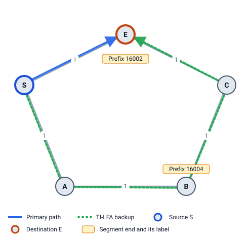

# Start here

This guide teaches **IP Fast Reroute (FRR)** for IS-IS networks: what happens when a link or router fails, and how routers keep traffic moving in the 50 ms before the network has fully reacted. It covers the three backup methods LFA Lab computes:

| Method | Standard | Idea in one line |
|---|---|---|
| **LFA** (Loop-Free Alternate) | RFC 5286 | Send traffic to a neighbor that won't send it back to you. |
| **Remote LFA** | RFC 7490 | No safe neighbor? Tunnel the traffic to a safe router further away. |
| **TI-LFA** (Topology-Independent LFA) | RFC 9855 | Use Segment Routing labels to steer traffic along the path the network will use after the failure. |

By the end you will be able to work out each backup by hand, check your answer in LFA Lab, and explain *why* a method works or fails in a given network.

## Who it is for

- **Students** on CCNP / JNCIE / university networking courses.
- **Network engineers** who want to check a design's protection.
- **Interview candidates** for network software roles.

## What you need to know first

- What a router, a link and an IP packet are.
- That routers pick the cheapest path, where every link has a cost ("metric").

That is all. Chapter 1 explains the IS-IS parts you need, and chapter 6 explains Segment Routing from zero.

## How to use this guide with the app

Every chapter has the same shape:

1. **The idea**, in plain words.
2. **A diagram** drawn from one of the built-in examples, with the engine's own results.
3. **A worked example** with real numbers, e.g. `dist(N,D)=10 < dist(N,S)+dist(S,D)=35 ✓`.
4. **Try it in LFA Lab**: a link that loads the example in the app, so you can click around and see the same numbers.
5. **Check yourself**: three short questions, with answers hidden until you open them.

In the app, open this guide with the **📖 Learn** button in the top bar. A "Try it" link loads the example on the diagram while the guide stays open beside it. Close the guide with ✕ or Esc; the button opens it again at the same chapter.

On GitHub, the "Try it" links open the example's YAML file. Load it in the app with **Import YAML**, or pick it from **Examples…**.

### How to read the diagrams

- **Blue solid line:** the primary path, the one traffic takes when nothing is broken.
- **Orange / brown / green dashed lines:** backup paths (LFA, Remote LFA, TI-LFA).
- **Thick blue ring:** the source router S, the router that repairs the traffic.
- **Thick orange ring:** the destination D.
- **Shaded routers:** P-space (blue), Q-space (green), both (half and half). ★ marks the chosen PQ node.
- **Numbers on links:** the metric. `20 / 40` means 20 one way and 40 the other (first number: from the router listed first in the YAML file).
- **Red dotted line with ✕:** a failed link.

The same colours are used on the app's diagram.

## Reading order

| Part | Chapters | Time |
|---|---|---|
| 1. Basics | [1 IS-IS in 10 minutes](01-isis-basics.md), [2 Shortest paths](02-shortest-paths.md), [3 When a link fails](03-when-a-link-fails.md) | 40 min |
| 2. The three methods | [4 LFA](04-lfa.md), [5 Remote LFA](05-remote-lfa.md), [6 Segment Routing primer](06-segment-routing.md), [7 TI-LFA](07-ti-lfa.md), [8 Side by side](08-comparison.md) | 1.5 h |
| 3. Real networks | [9 Router and multiple failures](09-router-and-multiple-failures.md), [10 Design checks](10-design-checks.md), [11 Advanced topics](11-advanced-topics.md) | 1 h |
| 4. Practice | [12 Using LFA Lab](12-using-lfa-lab.md), [13 Practice exercises](13-practice-exercises.md) | as long as you like |
| Appendix | [Glossary](appendix-a-glossary.md), [Formula cheat sheet](appendix-b-cheat-sheet.md), [RFC reading guide](appendix-c-rfc-guide.md), [Examples index](appendix-d-examples.md) | reference |

If you only have 30 minutes, read chapters 4, 5 and 7 and do the "Try it" boxes.

## Notation used everywhere

| Symbol | Meaning |
|---|---|
| **S** | Source: the router that computes the backup and repairs the traffic (the "point of local repair", PLR) |
| **D** | Destination router |
| **E** | S's primary next hop towards D: the neighbor S normally sends to |
| **N** | Another neighbor of S: a candidate backup |
| `c(X,Y)` | Metric of the link X→Y |
| `dist(X,Y)` | Cost of the cheapest path from X to Y in the normal network, before anything fails |

`dist(X,Y)` can differ from `dist(Y,X)` when a link has a different metric each way.

Next: [1 IS-IS in 10 minutes](01-isis-basics.md)
