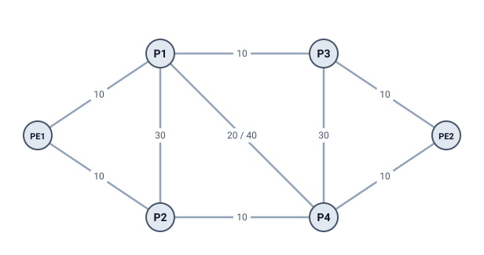

# 1 · IS-IS in 10 minutes

IS-IS is a **link-state routing protocol**: every router learns the whole map of the network and works out the best paths itself. This chapter covers only what you need for Fast Reroute. (OSPF works the same way for everything in this guide; only the words differ.)

## Routers, links and metrics

- A **router** has a name (here PE1, P1, …) and, for Segment Routing, a **SID index** (chapter 6).
- A **link** joins two routers. Each direction has a **metric**: a whole number, the cost of sending traffic that way. IS-IS "wide metrics" go from 1 to 16,777,215.
- A path's cost is the sum of its link metrics. Routers always prefer the **cheapest** path.

Metrics are set by the operator. They often follow link speed (a 100G link gets a lower metric than a 10G one) or distance, but any number is allowed.

### A metric can differ in each direction

On the diagram, link P1–P4 shows `20 / 40`: it costs 20 from P1 to P4 and 40 from P4 to P1. So:

- the cheapest path P1 → P4 is the direct link: 20;
- the cheapest path P4 → P1 is **not** the direct link (40). It costs 30, and there are two such paths: P4 → P2 → PE1 → P1 and P4 → PE2 → P3 → P1 (10 + 10 + 10 each).

That is why this guide writes `dist(X,Y)` and never assumes it equals `dist(Y,X)`. Remote LFA (chapter 5) needs distances in both directions for exactly this reason.

## Link-state: every router has the same map

Each router tells every other router about itself in a **Link State PDU (LSP)**: "I am P1, I have links to PE1 (metric 10), P2 (30), P3 (10) and P4 (20)". LSPs are **flooded**: each router passes them on to all its neighbors, so after a moment every router holds every LSP. Together they form the **link-state database (LSDB)**, the same map on every router.

Each router then runs **SPF** (Shortest Path First, Dijkstra's algorithm, chapter 2) on that map, with itself as the root. The result is its **routing table**: for each destination, the next hop to send to.

Two facts matter a lot for FRR:

1. **Every router can compute every other router's paths.** S has the whole map, so it can run SPF *as if it were* its neighbor N and learn where N would send a packet. LFA (chapter 4) depends on this.
2. **After a change, routers update one at a time.** A failure has to be detected, flooded, and recomputed on each router. Until all are done, some routers use the old map and some the new one (chapter 3).

## Point-to-point links and LANs

Most core links join exactly two routers (**point-to-point**). An Ethernet segment with three or more routers is a **broadcast LAN**. IS-IS models a LAN as a **pseudonode**: a fake router in the middle that every member reaches at its own metric and that reaches every member at 0. LFA Lab draws it as a small grey square. LANs change some FRR rules (chapter 11).

## Level 1 and Level 2

Large IS-IS networks are split into **areas**. Routers inside an area form **Level 1** (L1); the backbone that joins the areas is **Level 2** (L2). A router can be L1, L2 or both (L1/L2). Each level has its own map and its own SPF, so FRR is worked out per level. Chapter 11 shows this with Example 10.

## The overload bit

A router can set the **overload bit** in its LSP to say "don't send transit traffic through me", for example while it boots or during maintenance. Other routers still reach it, but never route *through* it. It can't be used as a backup either (chapter 10).

## What LFA Lab models

- Routers with a SID index, links with a metric per direction, parallel links, LANs, levels, the overload bit.
- Each router's loopback is a destination. LFA Lab does not model other prefixes, timers or real packets.
- Everything runs in your browser, from the map you draw or load.

> **Try it in LFA Lab**
>
> - [Open Example 4](../../examples/04-isp-core.yaml#source=PE1). Hover over link P1–P4 to see its two metrics.
> - In the results table (source PE1), read the **Cost** column: the cost to P4 is 20 (PE1 → P2 → P4).
> - Pick **P4** as the source router. Its cost to P1 is 30, not 40: the direct link is the expensive direction.

## Check yourself

1. Why can every IS-IS router compute its neighbor's best path?
2. In Example 4, what is `dist(P1,P4)` and what is `dist(P4,P1)`?
3. What does the overload bit ask other routers to do?

Answers

1. Every router holds the same link-state database (the whole map), so it can run SPF from any router as the root.
2. `dist(P1,P4) = 20` (direct link). `dist(P4,P1) = 30` (P4 → P2 → PE1 → P1, or P4 → PE2 → P3 → P1), because the direct link costs 40 that way.
3. Not to send traffic *through* that router. It can still be a destination.

Next: [2 Shortest paths (SPF)](02-shortest-paths.md)
