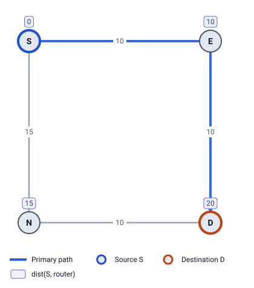

# 2 · Shortest paths (SPF)

Every backup method in this guide is built from **shortest-path distances**. This chapter shows how a router computes them, and the few extra ideas FRR needs: `dist(X,Y)`, ECMP and reverse SPF.

## Dijkstra, step by step

IS-IS runs **Dijkstra's algorithm** (SPF) with the router itself as the root. The idea: grow a set of routers whose cheapest cost is known, always adding the closest one next.



Example 1 is a square: S–E 10, E–D 10, S–N 15, N–D 10. Run SPF from S:

| Step | Pick (cheapest not yet done) | Update its neighbors | Known so far |
|---|---|---|---|
| 1 | S (0) | E: 0 + 10 = 10 · N: 0 + 15 = 15 | S 0 |
| 2 | E (10) | D: 10 + 10 = 20 | S 0, E 10 |
| 3 | N (15) | D: 15 + 10 = 25, not better than 20, keep 20 | S 0, E 10, N 15 |
| 4 | D (20) | nothing new | S 0, E 10, N 15, D 20 |

Result: `dist(S,E)=10`, `dist(S,N)=15`, `dist(S,D)=20`. The best path to D is S → E → D, so S's **next hop** for D is **E**. That is the blue line on the diagram.

## `dist(X,Y)` from any router

S has the whole map (chapter 1), so it can run the same algorithm with *any* router as the root. FRR needs this all the time: "where would neighbor N send this packet?" is answered by SPF from N. For Example 1:

| From \ to | S | E | N | D |
|---|---|---|---|---|
| **S** | 0 | 10 | 15 | 20 |
| **E** | 10 | 0 | 20 | 10 |
| **N** | 15 | 20 | 0 | 10 |
| **D** | 20 | 10 | 10 | 0 |

Read it as `dist(row, column)`. For example `dist(N,E) = 20`: N → D → E costs 10 + 10 = 20, cheaper than N → S → E (15 + 10 = 25).

LFA Lab computes this whole table (one SPF per router) and reuses it for every check.

## ECMP: more than one best path

Sometimes two paths cost exactly the same. Then the router keeps **both** next hops and spreads traffic over them: **Equal-Cost Multi-Path (ECMP)**.

In Example 5 (leaf-spine, every link 10), leaf L1 reaches leaf L2 through SP1 (10 + 10 = 20) *and* through SP2 (20). L1 has two next hops for L2.

ECMP is also the simplest protection there is: if the link to SP1 fails, L1 just keeps using SP2. LFA Lab calls this **ECMP-protected**. Nothing has to be computed in advance.

## Reverse SPF: distances *to* a router

Dijkstra from X gives `dist(X, everything)`. Sometimes we need the opposite, `dist(everything, Y)`: how far every router is *from* Y's point of view, towards Y. With equal metrics both ways these are the same numbers. With different metrics each way they are not, so the router runs SPF on the map with every link turned around (**reverse SPF**).

Remote LFA's Q-space (chapter 5) needs `dist(Y,E)` for every Y, which is a reverse SPF rooted at E.

## "Does this path use that link?"

FRR keeps asking: "does every shortest path from X to Y avoid the link S→E?" There is a neat test that needs only distances:

```
dist(X,Y) < dist(X,S) + c(S,E) + dist(E,Y)
```

The right side is the cheapest path from X to Y that is *forced* through S→E. If the real shortest path is strictly cheaper, no shortest path uses the link. If the two are **equal**, some equal-cost path might use it, so the safe answer is "it may use the link". This "strictly less than" rule appears in every inequality in the next chapters.

## Ties: one path to draw

When two paths tie, LFA Lab draws one: at each step it takes the neighbor with the **lowest router id** (alphabetical). This doesn't change any protection result. It only makes the drawings and the failure simulation the same every time.

> **Try it in LFA Lab**
>
> - [Open Example 1](../../examples/01-square.yaml#source=S&dest=D&via=E). The row S → D is open: cost 20, next hop E.
> - Double-click link S–E and change its metric to 15. Now both paths to D cost 25: the row shows **two** next hops (ECMP). Undo with Ctrl+Z.
> - [Open Example 5](../../examples/05-leaf-spine.yaml#source=L1). Every leaf has two next hops (SP1, SP2) and is marked ECMP-protected.

## Check yourself

1. In Example 1, what are `dist(E,N)` and S's next hop for N?
2. Why does FRR use `<` and not `≤` in "all shortest paths avoid the link"?
3. When do you need reverse SPF?

<details>
<summary>Answers</summary>

1. `dist(E,N) = 20` (E → D → N; E → S → N would be 25). S's next hop for N is N itself: the direct link costs 15, the path via E costs 30.
2. With `=`, there is an equal-cost path that goes over the link, and the router might be using it. Only `<` proves every shortest path avoids it.
3. When metrics differ per direction and you need distances *towards* a router, such as `dist(Y,E)` for Remote LFA's Q-space.

</details>

Next: [3 What happens when a link fails](03-when-a-link-fails.md)
