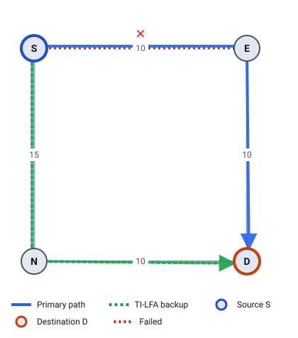

# 3 · What happens when a link fails

Chapter 2 gave every router a next hop for every destination. Now a link breaks. This chapter explains why the network loses traffic for a while, and the idea that fixes it: **Fast Reroute**.

## Convergence: the slow way

In Example 1, S sends traffic for D to E. Now link S–E fails. Without FRR, this happens:

| Step | What happens | Typical time |
|---|---|---|
| 1. Detect | S and E notice the link is down (loss of light, or BFD stops getting replies) | 10–50 ms |
| 2. Flood | S and E send new LSPs without the link; every router passes them on | tens of ms per hop |
| 3. Compute | Each router runs SPF again on the new map | a few ms to 100s of ms |
| 4. Install | Each router writes the new next hops into its forwarding hardware | can be 100s of ms for many routes |

Only after step 4 does S send D's traffic to N (the green path, S → N → D, cost 25). Until then, **traffic sent to S–E is dropped**. In a big network, convergence can take hundreds of milliseconds or more. Voice calls, video and financial traffic notice that.

The path after step 4 is called the **post-convergence path**: S's shortest path in the network without the failed link. Remember this term; TI-LFA (chapter 7) is built on it.

## The idea of Fast Reroute

Steps 2–4 are slow because they involve other routers. Step 1 is local and fast. So:

> Work out a backup **before** anything fails, and store it next to the primary next hop. When S detects the failure, it switches to the backup at once, without waiting for anyone.

This is **IP Fast Reroute (FRR)**. The router that switches is the **point of local repair (PLR)**, which is S in this guide. Every other router keeps its old routing table for now. The switch takes about the time of step 1, so the loss is about **50 ms or less**. Then normal convergence runs in the background, and when it finishes, S moves to its new best path.

The hard part is the backup itself. All other routers are still using the **old** map. A backup only works if those routers forward the traffic to D *without sending it back over the broken link*. Each method in Part 2 solves this differently:

- **LFA:** pick a neighbor whose old shortest path to D already avoids the failed link.
- **Remote LFA:** tunnel the traffic to a router further away whose old path to D avoids it.
- **TI-LFA:** put a list of labels on the packet that steers it along the post-convergence path, using only the routers' old tables.

## Microloops: trouble during convergence

Even after the backup has done its job, steps 2–4 still happen on each router **at its own pace**. While some routers use the new map and some the old one, traffic can bounce between two of them for a moment: a **microloop**.

Example 2 (the five-router ring, all metrics 1) with link S–E failed, traffic for E:

- A's old path to E is A → S → E (cost 2; A → B → C → E costs 3).
- S's new path to E is S → A → B → C → E.

If S updates first and A hasn't yet, S sends to A and A sends straight back to S: **A → S → A**. It lasts until A updates. Chapter 11 shows how LFA Lab finds these loops and how "local convergence delay" (RFC 8333) avoids this one.

## What to protect against

A backup is built to survive one specific failure:

| Protection | Survives | Used for |
|---|---|---|
| **Link** | the link S–E | the default everywhere in this guide |
| **Node** | the whole router E, with all its links | E reboots or crashes |
| **SRLG** | every link that shares a risk with S–E (same fibre duct, same line card) | one cut takes down several links |

Link protection is the easiest to get. Node and SRLG protection need a backup that goes *further around* the trouble. Chapters 5, 7 and 9 show both.

> **Try it in LFA Lab**
>
> - [Open Example 1 with S–E failed](../../examples/01-square.yaml#source=S&dest=D&via=E&fail=S-E). The failure panel shows the traffic for D taking the backup S → N → D.
> - Press **2. Converge ▶** to see the path after the network reconverges. Here it is the same path.
> - [Open Example 2 with S–E failed](../../examples/02-ring5.yaml#source=S&dest=E&via=E&fail=S-E) and open **Microloops while the network converges** in the failure panel.

## Check yourself

1. Which convergence step does FRR skip, and why does that make it fast?
2. What is the post-convergence path?
3. In the ring, why can S and A loop for a moment after S–E fails?

Answers

1. It doesn't wait for flooding, SPF on other routers or installing new routes (steps 2–4). The backup is already installed, so S switches as soon as it detects the failure (step 1).
2. S's shortest path to D in the network without the failed element: where S will send traffic once every router has reconverged.
3. If S has updated (new next hop A) but A hasn't (old next hop S), each sends the traffic to the other.

Next: [4 LFA](04-lfa.md)
