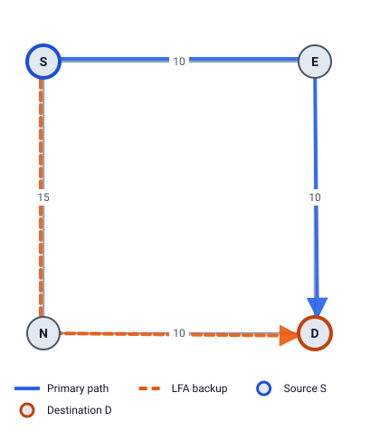
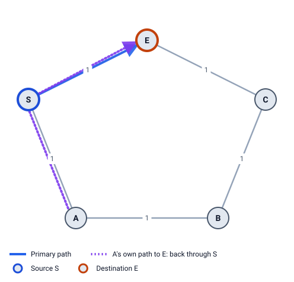

# 4 · LFA: Loop-Free Alternates (RFC 5286)

LFA is the simplest backup: when the link to E fails, **send the traffic to another neighbor N instead**. N then forwards it on its normal (old) routing table. It works only if N won't send the traffic straight back to S.

## The core idea

S has the whole map, so it knows N's shortest path to D. There are two cases:

- N's path to D goes **back through S**: S sends to N, N sends back to S, S sends to N again… a loop. Useless.
- N's path to D **doesn't** go through S: the traffic reaches D. N is a **loop-free alternate**.

All of LFA is about checking this one thing with distances.

## Inequality 1: loop-free (required)

```
dist(N,D) < dist(N,S) + dist(S,D)
```

The right side is the cost of N's best path to D *if it went through S*. If N's real best path is strictly cheaper, N doesn't go through S. This is the only check an LFA **must** pass.



**Example 1** (S–E 10, E–D 10, S–N 15, N–D 10). S → D goes via E (`dist(S,D) = 20`). Is N a loop-free alternate?

`dist(N,D) = 10 < dist(N,S) + dist(S,D) = 15 + 20 = 35` ✓

Yes. If S–E fails, S sends D's traffic to N, and N sends it straight to D. Cost of the backup: `c(S,N) + dist(N,D) = 15 + 10 = 25`.

## Inequality 2: downstream (stronger)

```
dist(N,D) < dist(S,D)
```

N is **closer to D** than S is. A downstream neighbor can never send traffic back to S, and it also prevents loops between two routers that both use alternates at the same time.

Example 1: `10 < 20` ✓. N is downstream.

## Inequality 3: node-protecting (stronger still)

```
dist(N,D) < dist(N,E) + dist(E,D)
```

N's path to D **doesn't go through router E**. Then the backup survives even if the whole router E fails, not only the link.

Example 1: `dist(N,E) = 20` (N → D → E), so `10 < 20 + 10 = 30` ✓. N is node-protecting.

**Result for Example 1:** N is a node-protecting, downstream LFA. The best kind there is.

## Where LFA fails: the ring problem



**Example 2** is a ring S – E – C – B – A – S, every metric 1. Destination E, protect link S–E. S's only other neighbor is A.

`dist(A,E) = 2 < dist(A,S) + dist(S,E) = 1 + 1 = 2` ✗ (2 is not less than 2)

A's shortest path to E is A → S → E (cost 2), through S. If S sent E's traffic to A, A would send it straight back. **No LFA.** Rings are the classic case: the neighbor on the "other side" is only loop-free for destinations close to it.

For destination C, though, A works: `dist(A,C) = 2` (A → B → C) `< dist(A,S) + dist(S,C) = 1 + 2 = 3` ✓. So in the same ring, some destinations have an LFA and some don't. Over the whole ring, LFA protects **50%** of (destination, link) pairs.

## A link-protecting LFA

**Example 6:** S–E 1, E–D 1, S–N 1, N–E 1, N–M 10, M–D 10. S → D goes via E (cost 2). Check N:

| Check | Numbers | Result |
|---|---|---|
| Loop-free | `dist(N,D) = 2 < dist(N,S) + dist(S,D) = 1 + 2 = 3` | ✓ |
| Downstream | `2 < dist(S,D) = 2` | ✗ |
| Node-protecting | `2 < dist(N,E) + dist(E,D) = 1 + 1 = 2` | ✗ |

N is an LFA, but its path to D is N → E → D: through E. It protects against the *link* S–E failing, but if *router* E fails, the backup breaks. Chapter 9 shows what then happens.

## Choosing the best LFA

S may have several loop-free neighbors. LFA Lab picks one in this order (RFC 5286 §3.2 lists the criteria; the exact order is a policy, chapter 10):

1. node-protecting before link-protecting only
2. then downstream before not downstream
3. then the lowest backup cost `c(S,N) + dist(N,D)`
4. then the lowest router id
5. then the lowest link id (only matters for parallel links)

## Some details

- **ECMP first.** If D has two primary next hops, the other one is the backup, with no computation (chapter 2).
- **Neighbors that are never used:** a neighbor whose link to or from S has the maximum metric 16,777,215, and a neighbor with the overload bit set (RFC 5286 §3.5).
- **Parallel links:** another link to E itself can be an LFA: it is loop-free and downstream, but never node-protecting (it ends at E). Chapter 11.
- **No new labels, no tunnels.** S just sends to another neighbor. That is why LFA is cheap and supported everywhere, and why it doesn't always work.

> **Try it in LFA Lab**
>
> - [Open Example 1, row S → D](../../examples/01-square.yaml#source=S&dest=D&via=E). In the detail panel, read **Explain**: the three inequalities with these numbers.
> - [Open Example 2, row S → E](../../examples/02-ring5.yaml#source=S&dest=E&via=E). Explain shows `dist(A,E)=2 < dist(A,S)+dist(S,E)=2 ✗`.
> - In the same example, open the row for **C**: A is an LFA there.
> - [Open Example 6, row S → D](../../examples/06-link-protecting.yaml#source=S&dest=D&via=E). The LFA column says N, but not node-protecting.

## Check yourself

1. Write Inequality 1 and say in words what it checks.
2. In Example 1, what is the cost of the LFA backup for D?
3. In Example 6, N is an LFA for D. Why does it fail if router E goes down?

<details>
<summary>Answers</summary>

1. `dist(N,D) < dist(N,S) + dist(S,D)`: N's shortest path to D is cheaper than any path through S, so N won't send the traffic back to S.
2. `c(S,N) + dist(N,D) = 15 + 10 = 25`.
3. N's shortest path to D is N → E → D. Inequality 3 fails (`2 < 1 + 1` ✗), so the backup goes through E.

</details>

Next: [5 Remote LFA](05-remote-lfa.md)
