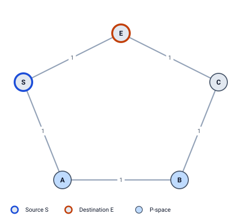
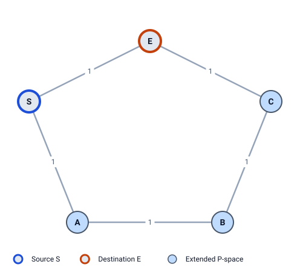
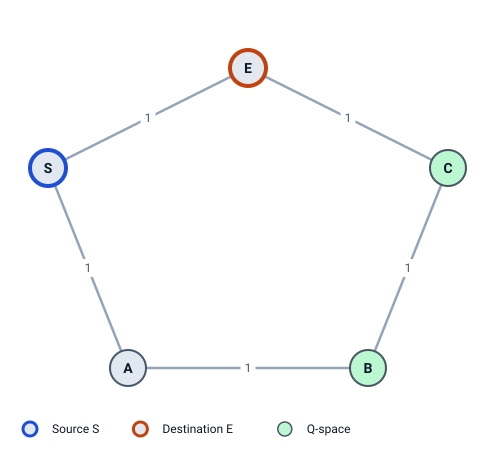
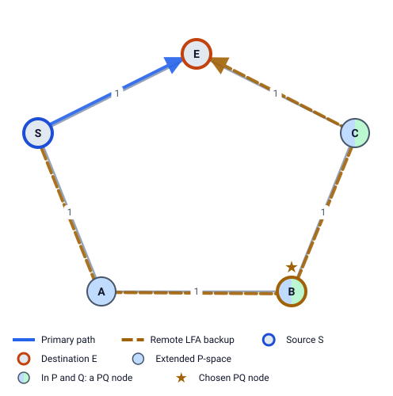
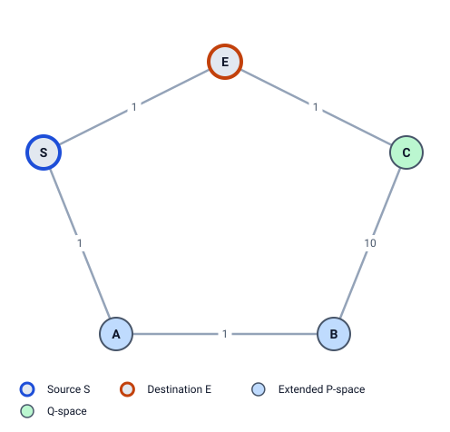
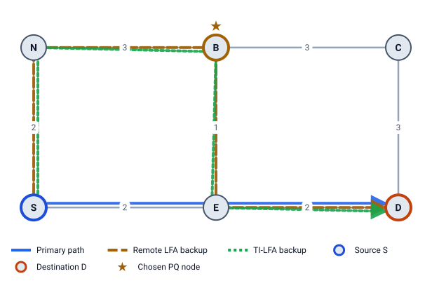
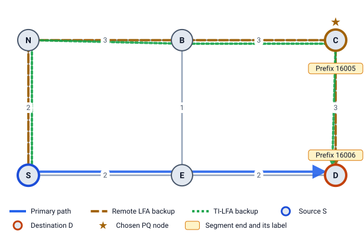

# 5 · Remote LFA (RFC 7490)

In the ring (Example 2) S has no LFA for E: its only other neighbor, A, would send the traffic back. Remote LFA's idea: **if no neighbor is safe, find a safe router further away and tunnel the traffic to it.** The tunnel carries the packet past A's bad decision.

To find that router, we need two sets: the routers S can reach safely (**P-space**), and the routers that can reach E safely (**Q-space**). A router in both is a **PQ node**.

## P-space: where S can send traffic safely

**P-space of S** (for the protected link S–E) = the routers S reaches on its normal shortest path **without using S–E**:

```
Y ∈ P(S)  ⇔  dist(S,Y) < c(S,E) + dist(E,Y)
```

The right side is the cheapest path from S to Y that starts with the link S–E. If S's real shortest path is strictly cheaper, it doesn't use S–E.



Example 2 (ring, all metrics 1), link S–E:

| Y | dist(S,Y) | c(S,E) + dist(E,Y) | In P(S)? |
|---|---|---|---|
| A | 1 | 1 + 2 = 3 | ✓ |
| B | 2 | 1 + 2 = 3 | ✓ |
| C | 2 | 1 + 1 = 2 | ✗ (tie) |

P(S) = {A, B}.

### Extended P-space

S can also send traffic out to a neighbor N first and let *N* forward it normally. So the routers N reaches without coming back through S are also usable:

```
Y ∈ P(N)  ⇔  dist(N,Y) < dist(N,S) + dist(S,Y)
```

**Extended P-space** = P(S) together with P(N) for every other neighbor N. In the ring, via A: `dist(A,C) = 2` (A → B → C) `< dist(A,S) + dist(S,C) = 1 + 2 = 3` ✓, so C joins.



Extended P-space = {A, B, C}. LFA Lab uses extended P-space by default; the **Extended P-space (RLFA)** checkbox switches to plain P-space.

## Q-space: who reaches E safely

**Q-space of E** = the routers whose normal shortest path **to E** doesn't use the link S–E:

```
Y ∈ Q(E)  ⇔  dist(Y,E) < dist(Y,S) + c(S,E)
```

Note the direction: `dist(Y,E)`, from Y towards E. With different metrics each way this needs reverse SPF (chapter 2).



| Y | dist(Y,E) | dist(Y,S) + c(S,E) | In Q(E)? |
|---|---|---|---|
| A | 2 | 1 + 1 = 2 | ✗ (tie) |
| B | 2 | 2 + 1 = 3 | ✓ |
| C | 1 | 2 + 1 = 3 | ✓ |

Q(E) = {B, C}. Once traffic reaches E, E forwards it to D normally. (Remote LFA always aims for E; E's Q-space works for every destination behind E.)

## PQ nodes and the repair

**PQ nodes** = extended P-space ∩ Q-space = {A, B, C} ∩ {B, C} = **{B, C}**.

A PQ node is reachable from S without the failed link, and reaches E without it. So S puts the packet in a **tunnel** to the PQ node; the PQ node takes it out and forwards it to E, then on to D.



### Which PQ node?

The lowest cost from S, then the lowest router id (RFC 7490 §5.2.2):

- B is in plain P(S): cost `dist(S,B) = 2`.
- C is only in A's P-space: cost `c(S,A) + dist(A,C) = 1 + 2 = 3`.

**Chosen PQ node: B.** The repair: tunnel S → A → B, then B → C → E. With plain P-space only, PQ = {B}, same choice.

### Which way the tunnel leaves S

- PQ node in plain P(S): the tunnel follows S's own shortest path (it already avoids S–E).
- PQ node only in some P(N): the tunnel must be **sent out through N**, because S's own shortest path to it may use the failed link. LFA Lab shows this "exit via N" in the detail panel.

### What the tunnel is

RFC 7490 allows any tunnel. Classic deployments used an LDP label learned over a targeted LDP session. With Segment Routing (chapter 6), the tunnel is just one extra label: the PQ node's Prefix-SID. LFA Lab shows that label.

Remote LFA only runs when there is **no LFA**. LFA Lab still shows the spaces for every row, for learning.

## Where Remote LFA fails



**Example 3** is the same ring, but **B–C costs 10**. Now:

- P(S) = {A, B}. Extended via A: `dist(A,C) = 3` (A → S → E → C; A → B → C costs 11) is not `< 1 + 2` ✗. Still {A, B}.
- Q(E): A `2 < 2` ✗; B: `dist(B,E) = 3` (B → A → S → E) is not `< dist(B,S) + 1 = 3` ✗; C `1 < 3` ✓. Q = {C}.

P ∩ Q = {} : **no PQ node, Remote LFA fails.** The P-space and Q-space don't touch: they are joined only by the expensive link B–C, which no shortest path uses. TI-LFA (chapter 7) solves this with an extra label.

## Node protection (RFC 8102)

Plain Remote LFA protects the link. If router E itself fails, the chosen PQ node's path may still go through E. RFC 8102 adds two checks for each PQ candidate Y:

1. The tunnel to Y avoids E: `dist(S,Y) < dist(S,E) + dist(E,Y)` (or the same through a neighbor N).
2. Y's own path to D avoids E: `dist(Y,D) < dist(Y,E) + dist(E,D)`.



**Example 8** (S–E 2, S–N 2, E–B 1, E–D 2, N–B 3, B–C 3, C–D 3), S → D via E:

- No LFA: `dist(N,D) = 6 < dist(N,S) + dist(S,D) = 2 + 4` ✗.
- Link-protecting Remote LFA: PQ = {B, C}, best **B** via N (cost 5). But B's path to D is B → E → D.
- Node checks: B fails check 2 (`dist(B,D) = 3 < dist(B,E) + dist(E,D) = 1 + 2` ✗). C passes both (`6 < 4 + 4` via N, and `3 < 4 + 2`).
- **Node-protecting PQ node: C** via N (cost 8). The repair S → N → B → C → D costs 11 and survives router E failing.



In LFA Lab, node protection is a network setting: **Topology settings → Backups protect against: Node failure** (in the sidebar) (`protection: node` in YAML). Example 8 has it on.

> **Try it in LFA Lab**
>
> - [Open Example 2, row S → E](../../examples/02-ring5.yaml#source=S&dest=E&via=E). In the detail panel, click the P, Q and PQ sets: they light up on the diagram.
> - Untick **Extended P-space (RLFA)** in the sidebar: C leaves P-space, PQ = {B}.
> - [Open Example 3, row S → E](../../examples/03-ring5-highmetric.yaml#source=S&dest=E&via=E): Q = {C}, no PQ node.
> - [Open Example 8, row S → D](../../examples/08-node-protection.yaml#source=S&dest=D&via=E): the PQ node is C, marked node-protecting.

## Check yourself

1. Write the P-space and Q-space tests.
2. In Example 2, why is C in extended P-space but not in plain P-space?
3. Why does Remote LFA fail in Example 3?

<details>
<summary>Answers</summary>

1. `Y ∈ P(S) ⇔ dist(S,Y) < c(S,E) + dist(E,Y)` and `Y ∈ Q(E) ⇔ dist(Y,E) < dist(Y,S) + c(S,E)`.
2. S's shortest path to C is S → E → C (cost 2), over the failed link: `dist(S,C) = 2` is not `< c(S,E) + dist(E,C) = 1 + 1`. But neighbor A reaches C on A → B → C (2), cheaper than going back through S (`1 + 2 = 3`), so C is in P(A), and S can reach it by sending out through A.
3. No router is in both sets: P = {A, B}, Q = {C}. The only link between them, B–C, costs 10, so no shortest path crosses it.

</details>

Next: [6 Segment Routing primer](06-segment-routing.md)
