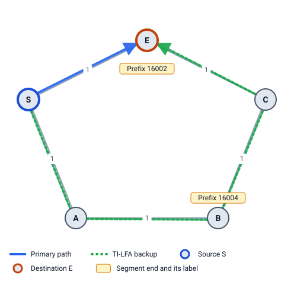
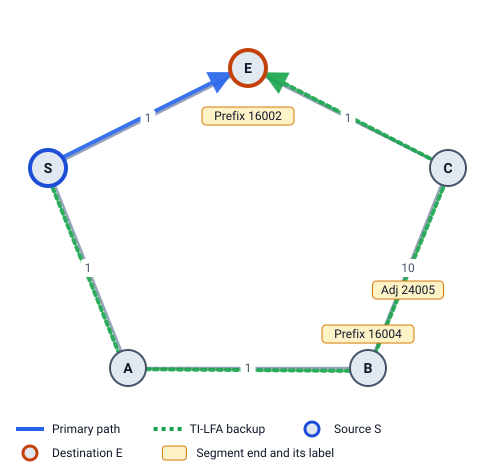

# 7 · TI-LFA: Topology-Independent LFA (RFC 9855)

LFA and Remote LFA both hope that some router's *normal* path happens to avoid the failure. In some networks none does (Example 3). TI-LFA stops hoping: it decides the backup path first, then writes a Segment Routing label list that forces the packet along it. With enough labels, any path works, so TI-LFA protects every destination that can still be reached at all.

## Step 1: the post-convergence path

TI-LFA picks a very good backup: **the path S will use after the network has reconverged**. Remove the failed link S–E (both directions) and run SPF from S. The shortest path to D is the **post-convergence path** (RFC 9855 §3).

Why this one?

- It is the cheapest path that avoids the failure.
- When convergence finishes, S keeps using the same path, so traffic doesn't move twice.

If several paths tie, LFA Lab takes the one with the lowest router ids, so the result is always the same.

## Step 2: turn the path into segments

Only S has switched to the repair. **Every other router still uses its old (pre-failure) table**, and a Prefix-SID follows those old tables. So TI-LFA walks along the post-convergence path and, at each point, jumps as far as it safely can:

```
current = S
while current ≠ D:
    Y = the furthest router on the path after `current` such that
        every old shortest path current → Y avoids the link S–E
    if there is such a Y:   add PrefixSID(Y),        current = Y
    else:                   add AdjSID(current → next router), current = next
```

The check "every old shortest path avoids S–E" is the test from chapter 2:
`dist(current,Y) < dist(current,S) + c(S,E) + dist(E,Y)`.

Two clean-up rules (RFC 9855 §5, §7.1):

- The repair is sent **out of the first link** of the path anyway, so a first segment that only reaches the first hop is dropped.
- The list always **ends with D's own Prefix-SID**: that's the packet's own label, which stays under the repair labels.

**Extra labels** = segments − 1 (D's own label doesn't count).

## Example 2: one extra label



Ring, all metrics 1, S → E, link S–E fails. Post-convergence path: **S → A → B → C → E** (cost 4).

- From S: can S reach C with a Prefix-SID? S's old path to C is S → E → C: uses S–E ✗. B? S's old path to B is S → A → B (2), and `2 < dist(S,S) + 1 + dist(E,B) = 0 + 1 + 2 = 3` ✓. So **PrefixSID(B)**.
- From B: E? B's old path to E is B → C → E (2): `2 < dist(B,S) + 1 + dist(E,E) = 2 + 1 + 0 = 3` ✓. So **PrefixSID(E)**, and we're at D.

Segment list `[PrefixSID(B), PrefixSID(E)]` = labels **16004, 16002**, sent out to A. One extra label. It matches Remote LFA's tunnel to B here.

## Example 3: an Adj-SID is needed



Same ring, but B–C costs 10. Remote LFA failed (chapter 5). Post-convergence path: **S → A → B → C → E** (cost 1 + 1 + 10 + 1 = 13).

- From S: furthest valid router is B (S → A → B avoids S–E) → **PrefixSID(B)**.
- From B: the next router is C, but B's old path to C is B → A → S → E → C (cost 4, cheaper than 10) and uses S–E ✗. No Prefix-SID works, so force the link: **AdjSID(B→C)**.
- From C: C's old path to E is the direct link ✓ → **PrefixSID(E)**.

Segment list `[PrefixSID(B), AdjSID(B→C), PrefixSID(E)]` = labels **16004, 24005, 16002**. Two extra labels. This is the classic "P and Q are adjacent" case: the Adj-SID carries the packet across the gap between P-space and Q-space.

### Packet walk (PHP on)

| Router | Arrives with | Does | Leaves with |
|---|---|---|---|
| S | 16002 | push 16004, 24005; send to A | 16004 24005 16002 |
| A | 16004 24005 16002 | forward to B; next router is B: pop 16004 (PHP) | 24005 16002 |
| B | 24005 16002 | its own Adj-SID: pop it, send on the link to C | 16002 |
| C | 16002 | next router is E: pop (PHP) | no label |
| E | no label | delivered | – |

Total cost 13, exactly the post-convergence cost.

## Example 1: zero extra labels

In the square, the post-convergence path is S → N → D. The walk gives `[PrefixSID(N), PrefixSID(D)]`; the first one only reaches the first hop, so it's dropped: **`[PrefixSID(D)]`**, zero extra labels. When the first hop is already an LFA, TI-LFA just sends the packet to it. Typical results:

| Extra labels | When |
|---|---|
| 0 | the first hop is an LFA |
| 1 | a PQ node exists on the path |
| 2 | P and Q are adjacent: Prefix-SID + Adj-SID |
| 3+ | rare, long detours |

## Why it always works

- The walk always moves forward (an Adj-SID moves at least one hop), so it ends.
- Each Prefix-SID segment follows old shortest paths that avoid the failed link, and costs what the post-convergence path costs there. So the repair is loop-free and costs exactly the post-convergence cost.
- The only way to fail: D can't be reached at all without the link (the network is split).

LFA Lab's tests check this on thousands of random networks.

## Node protection

With **Node failure** protection, TI-LFA removes the whole **router E** before computing the post-convergence path, and the check becomes "every old path avoids router E": `dist(X,Y) < dist(X,E) + dist(E,Y)`.

**Example 8** (`protection: node`), S → D via E: E removed, the path is S → N → B → C → D (11). From N, C passes (`dist(N,C) = 6 < dist(N,E) + dist(E,C) = 4 + 4`), from C, D passes. **`[PrefixSID(C), PrefixSID(D)]` = 16005, 16006**, out via N. With link protection it would be S → N → B → E → D with `16004, 16006`, through E.

If D is E itself, node protection can't apply, and LFA Lab falls back to link protection (marked "fallback").

## Max SID depth

TI-LFA can need many labels. If the label stack is longer than S's MSD, S can't install it. With `msd: 2` on Example 3, the S → E repair (3 labels: 16004, 24005, 16002) is **too deep** and counts as unprotected. On SRv6 the same repair is 2 SIDs and fits (chapter 11).

> **Try it in LFA Lab**
>
> - [Open Example 3, row S → E](../../examples/03-ring5-highmetric.yaml#source=S&dest=E&via=E). Read the segment list and the Explain steps for each segment.
> - Open the **Packet walk** and step through it with the arrows.
> - [Fail S–E](../../examples/03-ring5-highmetric.yaml#source=S&dest=E&via=E&fail=S-E&mode=tilfa) and watch the traffic follow the TI-LFA path.
> - In **Topology settings**, set **Max SID depth** to 2: the row turns "too deep".

## Check yourself

1. Why does TI-LFA use the post-convergence path?
2. In Example 3, why is PrefixSID(C) not allowed from B?
3. What does the TI-LFA repair look like when the first hop is already an LFA?

<details>
<summary>Answers</summary>

1. It is the cheapest path without the failure, and it is where S sends traffic after convergence, so traffic moves only once.
2. B still uses its old table, where its shortest path to C is B → A → S → E → C (4 < 10). That path crosses the failed link S–E.
3. Just D's own label, sent out to that first hop: zero extra labels.

</details>

Next: [8 LFA vs Remote LFA vs TI-LFA](08-comparison.md)
