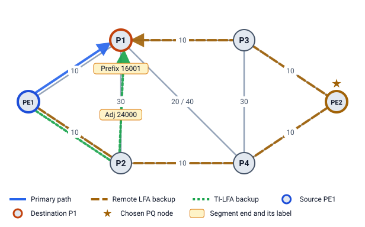

# 8 · LFA vs Remote LFA vs TI-LFA, side by side

You now know all three methods. This chapter puts them next to each other: what each needs, where each fails, and how they compare on the same failure.

## The comparison table

| | LFA | Remote LFA | TI-LFA |
|---|---|---|---|
| Standard | RFC 5286 | RFC 7490 (+ RFC 8102 for node protection) | RFC 9855 |
| Backup | another neighbor N | a tunnel to a PQ node | a segment list along the post-convergence path |
| Extra labels | 0 | 1 (the PQ node) | 0, 1, 2 or more |
| Needs | nothing | a tunnel: targeted LDP or SR | Segment Routing |
| Works when | some neighbor's old path avoids the link | P-space and Q-space overlap | D can still be reached at all |
| Coverage | depends on topology (rings are bad) | better, not complete | 100% unless the network splits |
| Backup = final path? | sometimes | sometimes | always (link protection) |
| When used | first choice | only if there is no LFA | when enabled; LFA Lab lists it for every row |

The **results table** names the simplest method that protects each row, in this order: **ECMP → LFA → Remote LFA → TI-LFA**.

## Four examples, three methods

| Example | LFA | Remote LFA | TI-LFA |
|---|---|---|---|
| 1, S → D, link S–E | **used**: N, S-N-D, cost 25 | not needed (PQ = N would give S-N-D) | S-N-D, 25, `16004` |
| 2, S → E, link S–E | none | **used**: PQ = B, S-A-B-C-E, 4 | S-A-B-C-E, 4, `16004 16002` |
| 3, S → E, link S–E | none | none (no PQ node) | **used**: S-A-B-C-E, 13, `16004 24005 16002` |
| 4, PE1 → P1, link PE1–P1 | none | **used**: PQ = PE2 via P2, cost 50, **longer** than the final 40 | PE1-P2-P1, 40, `24000 16001` |

Example 4 shows the difference best. When PE1–P1 fails:

- After convergence, PE1 reaches P1 over PE1 → P2 → P1 (10 + 30 = 40).
- Remote LFA's only PQ node is PE2, so traffic goes PE1 → P2 → P4 → PE2 → P3 → P1 (cost 50) for a while, then moves again to the 40 path when the network reconverges.
- TI-LFA uses the 40 path straight away. P2's old path to P1 is P2 → PE1 → P1 (20, over the failed link), so a Prefix-SID for P1 sent to P2 would come back. TI-LFA forces the link P2 → P1 with P2's Adj-SID (24000), then P1's own label (16001).

## Backup longer than the final path

LFA can also pick a backup that isn't the final path. A small network: S–E 1, E–D 1, S–N 5, N–D 1, S–M 1, M–N 1. For S → D, both M and N are node-protecting LFAs. N is downstream (`1 < 2`), M is not (`dist(M,D) = 2` is not `< 2`), so N wins: S → N → D costs 6. After convergence S uses S → M → N → D, which costs 3. The traffic is protected, but on a detour, and it moves twice.

TI-LFA never does this with link protection: its backup is the final path by construction.

## What "100%" means

LFA Lab's coverage counts **pairs**: (destination D, primary link S–E). Every destination behind every primary link is one pair. For the whole network it adds up every router as S.

| Network | LFA | LFA or Remote LFA | TI-LFA |
|---|---|---|---|
| Example 2 (ring, all 1) | 10 / 20 = 50% | 100% | 100% |
| Example 3 (B–C = 10) | 8 / 20 = 40% | 40% | 100% |

"TI-LFA 100%" means every pair has a repair *for a single link failure*. It does not mean every router failure or double failure is survived. Chapter 9 shows how link-protecting repairs can break.

> **Try it in LFA Lab**
>
> - [Open Example 4, row PE1 → P1](../../examples/04-isp-core.yaml#source=PE1&dest=P1&via=P1). The **Compare backups** cards show the three methods side by side, each with its own small diagram, cost and labels.
> - Use **Draw backup** to switch the big diagram between the LFA, Remote LFA and TI-LFA paths.
> - Open the **Coverage report** and switch **Which sources** to every router.

## Check yourself

1. Which method can protect when P-space and Q-space don't touch?
2. In Example 4, why does PE1's TI-LFA repair start with an Adj-SID?
3. Does "TI-LFA coverage 100%" mean every router failure is protected?

Answers

1. TI-LFA: an Adj-SID carries the packet across the gap.
2. P2's old shortest path to P1 goes back through PE1 and the failed link (P2 → PE1 → P1 = 20 < 30), so PrefixSID(P1) sent to P2 would loop. The Adj-SID forces P2 to use its direct link to P1.
3. No. It counts single *link* failures with the default link protection. A router failure can still break link-protecting repairs (chapter 9).

Next: [9 Router failures and multiple failures](09-router-and-multiple-failures.md)
