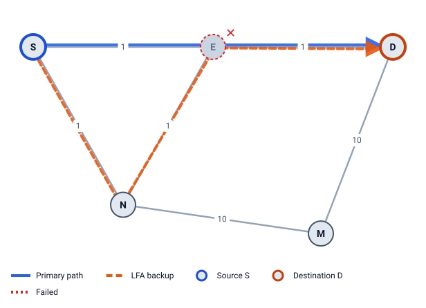
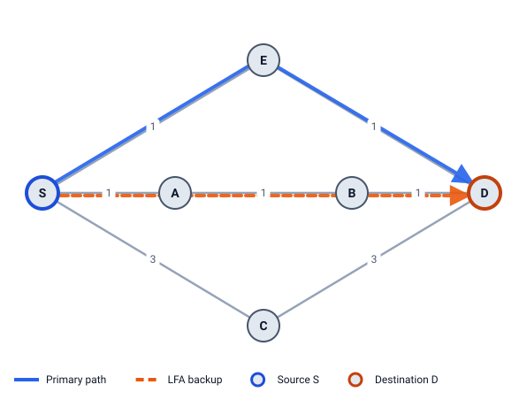
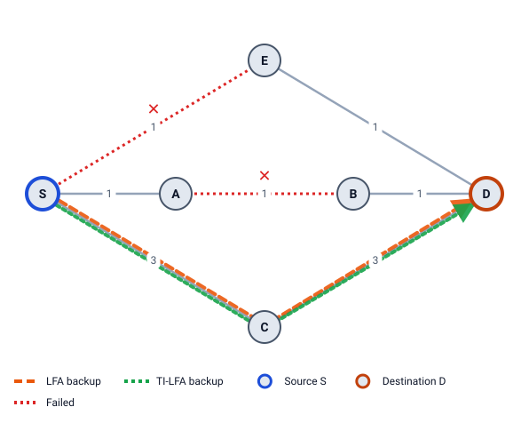

# 9 · Router failures and multiple failures

FRR backups are planned for **one** failure: by default, the link S–E. Real networks also lose whole routers, and sometimes several links at once. This chapter shows what happens to the plan then, using LFA Lab's failure simulation.

## How the simulation follows traffic

When you fail links or routers, LFA Lab follows each flow hop by hop:

1. Traffic follows S's normal path until it meets a failed link. The router just before it is the **PLR**.
2. The PLR switches to its pre-computed backup **for that one link**. Every other router keeps its old table.
3. If the backup runs into another failed link, the router there repairs again with *its own* backup.
4. The flow ends **delivered**, **dropped** (no backup), or **looped** (it came back to a router carrying the same thing as before).

Then **2. Converge ▶** shows the paths after every router has run SPF again.

## A router fails

When router E fails, all its links go down at once. E's neighbors don't know *why* their link went down; each one uses the backup it built for its own link. With the default link protection, **nobody planned for E itself**. So:

- A **node-protecting** backup (its path avoids E) survives.
- A **link-protecting** backup that goes through E breaks.

### Example 6: LFA survives by luck, TI-LFA loops

Example 6: S–E 1, E–D 1, S–N 1, N–E 1, N–M 10, M–D 10. Fail **router E**. Traffic from S to D:

- **LFA only:** S's LFA is N, which is link-protecting only (`dist(N,D) = 2` is not `< dist(N,E) + dist(E,D) = 1 + 1`). S sends to N, and N's normal path is N → E → D: broken at N. But N finds *its own* link to E down and uses *its own* LFA, M, which is node-protecting (`dist(M,D) = 10 < dist(M,E) + dist(E,D) = 11 + 1`). Traffic arrives on S → N → M → D (cost 21), after two repairs.
- **TI-LFA (link protection):** S's repair is `[PrefixSID(D)]` out via N, path S → N → E → D. N finds N–E down and uses its own TI-LFA path to D, N → S → E → D, which sends the packet back to S with the same label. S sends it to N again: a **loop**.

The lesson: with a router down, **link-protecting TI-LFA can do worse than plain LFA**, because each router only plans for its own link (RFC 9855 §1). With **Node failure** protection on, TI-LFA's repair avoids E and delivers on S → N → M → D.

### Example 1: a node-protecting LFA survives

Fail router E in the square. D's LFA N is node-protecting (`10 < 20 + 10`), so S → N → D (25) survives in every mode. E itself is unreachable, which is expected: it is shown on its own line, not as a protection failure.

## Several links fail

FRR is designed for one failure, but the simulation lets you fail more.

**Example 2, fail S–E and E–C**, traffic to E, TI-LFA:

- S's repair goes S → A → B → C → E, but at C the link C–E is down too.
- C's own TI-LFA backup for E goes back through B and A to S.
- At S it is the same packet as at the start: it **loops**.

E has lost both its links, so after convergence it is unreachable anyway. Traffic to C survives: its repair S → A → B → C avoids E–C.

**A third path.** S–E 10, E–D 10, S–A 10, A–D 15, A–B 10, B–D 10. Fail S–E and A–D: S's backup S → A → D runs into A–D at A; A's own backup A → B → D avoids both, so traffic reaches D on S → A → B → D (30). Two routers repaired in turn, and it worked.

## SRLG: links that fail together

Two links in one fibre duct fail together when a digger cuts the duct. A **Shared Risk Link Group (SRLG)** names that shared risk: each link lists its groups (`srlg: [duct-1]`). A backup over a link of the same group is no backup.

**Example 9:** S–E 1, E–D 1, S–A 1, A–B 1, B–D 1, S–C 3, C–D 3. Links S–E and A–B are both in `duct-1`. S → D via E (cost 2):

| | via A | via C |
|---|---|---|
| Loop-free | `dist(A,D) = 2 < 1 + 2` ✓ | `3 < 3 + 2` ✓ |
| Node-protecting | `2 < dist(A,E) + dist(E,D) = 2 + 1` ✓ | `3 < 4 + 1` ✓ |
| SRLG-disjoint | A's path A → B → D uses A–B ✗ | ✓ |
| Cost | 3 | 6 |

- **Link protection** picks A (cheaper). Fail the duct, and A's path hits A–B: A must repair again.
- **SRLG protection** prefers SRLG-disjoint LFAs first, so it picks **C**. TI-LFA removes S–E *and* A–B: path S → C → D, `[PrefixSID(D)]` = `16006`. Fail the duct: delivered by S alone.

In LFA Lab: **Topology settings → Backups protect against: Link + SRLG** (`protection: srlg`), and **Fail SRLG duct-1** on a link's form or right-click menu fails the whole group.

> **Try it in LFA Lab**
>
> - [Open Example 6 with router E down](../../examples/06-link-protecting.yaml#source=S&dest=D&via=E&down=E&mode=lfa). The failure panel says S's LFA breaks at N, and N repairs again via M.
> - Switch **Routers run:** to TI-LFA: the traffic loops between S and N. Open **Compare backups** to see all three modes at once.
> - [Open Example 2 with S–E and E–C down](../../examples/02-ring5.yaml#source=S&dest=E&via=E&fail=S-E,E-C&mode=tilfa) and follow the loop in the packet walk.
> - [Open Example 9 with the duct failed](../../examples/09-srlg.yaml#source=S&dest=D&via=E&fail=S-E,A-B).

## Check yourself

1. When router E fails, which backups survive?
2. In Example 6, why does link-protecting TI-LFA loop when E fails?
3. Why does SRLG protection pick C in Example 9, although A is cheaper?

Answers

1. Backups whose path avoids E: node-protecting ones. Link-protecting backups that go through E break (though another router may repair again).
2. S's repair goes via N towards E. N's own link to E is down, and N's own repair for D goes back through S. S receives the same packet again and sends it to N: a loop.
3. A's path to D uses A–B, which is in the same duct as S–E. C's path avoids every link of the duct.

Next: [10 Design checks](10-design-checks.md)
