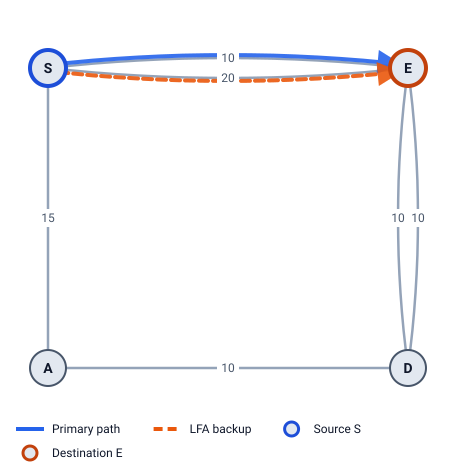
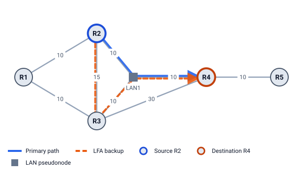
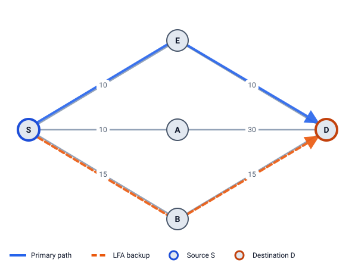
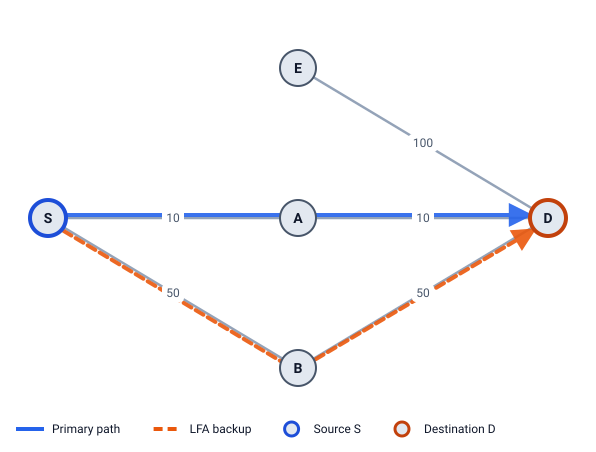

# 11 · Advanced topics

Real networks have bundles of parallel links, Ethernet LANs, several IS-IS levels, special-purpose topologies and IPv6 data planes. This chapter shows how FRR works in each, with one example per topic.

## Parallel links

Two routers can be joined by several links (a bundle). Each link has its own id (`S-E`, `S-E#2`), metric and Adj-SID, and each is protected on its own.

**Example 7:** S–E is a bundle of 10 (`S-E`) and 20 (`S-E#2`); E–D is a bundle of two 10s; S–A 15, A–D 10.

- **S → E, protect `S-E`:** the other link to E is a candidate. Loop-free `0 < 10 + 10` ✓, downstream `0 < 10` ✓, but never node-protecting (it ends at E). A is loop-free too (`20 < 15 + 10`) but not downstream. **Best LFA: E over `S-E#2`** (cost 20).
- **S → D, protect `S-E`:** A is node-protecting (`10 < 20 + 10`), E over `S-E#2` is not, so **A** wins.
- **E → D:** two equal links, so each protects the other (ECMP).

TI-LFA removes only the failed link, so the other link of the bundle stays usable, and an Adj-SID always names one link.

## LANs and pseudonodes

On a broadcast LAN, S's link to E is really **S's interface** to the LAN. If it fails, S loses every neighbor on that LAN at once. So an alternate "across the same LAN" is no alternate (RFC 5286 §3.6).

**Example 10:** LAN1 = {R2, R3, R4}, metric 10 into the LAN. R1–R2 10, R1–R3 10, R2–R3 15, R3–R4 30, R4–R5 10. R2 → R4 over LAN1 (cost 10):

- R3 over the LAN: **skipped**, same LAN.
- R1: `dist(R1,R4) = 20 < dist(R1,R2) + dist(R2,R4) = 10 + 10` ✗ (tie).
- R3 over the point-to-point link R2–R3: `10 < 10 + 10` ✓. **LFA = R3 over R2–R3**, cost 25.
- TI-LFA: R2's whole LAN interface removed: R2 → R3 (15) → R4 (over the LAN, 10) = 25, `[PrefixSID(R4)]` = `16004`, out on R2–R3.

## Multi-level IS-IS

Each IS-IS level has its own SPF and its own FRR, so LFA Lab shows one level at a time. In Example 10, R1 and R5 are Level-1 only, in areas 49.0001 and 49.0002.

| Level | Routers | Links |
|---|---|---|
| Level-2 | R2, R3, R4 | R2–R3, R3–R4, LAN1 |
| Level-1, area 49.0001 | R1, R2, R3 | R1–R2, R1–R3, R2–R3, LAN1 (R2, R3) |
| Level-1, area 49.0002 | R4, R5 | R4–R5 |

Pick one with the **IS-IS level** picker in the sidebar. LFA Lab doesn't model traffic between levels (default routes, route leaking).

## Microloops

Chapter 3 introduced microloops: while routers update one by one, two of them can send traffic back and forth. LFA Lab's failure panel lists the loops some update order can make.

| Network, failure | Loop | Avoided by local delay? |
|---|---|---|
| Example 2, S–E | to E: A → S → A (S updated, A not yet) | yes |
| Example 1, S–E | to S: D → E → D | yes |
| S–E 1, E–D 1, S–A 1, A–D 5; E–D fails | to D: A → S → A | no |

**Local convergence delay** (RFC 8333): a PLR keeps using its FRR repair for a while after it has computed its new path, so the others update first. That avoids every loop that needs the PLR to update early. In the third row the PLR is E, which isn't in the loop, so the delay doesn't help.

## Flex-Algo

A **Flexible Algorithm** (RFC 9350) is a second SPF in the same network with its own metric (IGP, TE metric or delay) and its own link rules (e.g. "never use red links"). Each router gets another Prefix-SID for it. FRR for a Flex-Algo **must stay inside that algorithm** (RFC 9350 §6.1).

**Example 11:** S–E 10 (delay 100, red), E–D 10 (delay 100), S–A 10 (delay 10), A–D 30 (delay 10), S–B 15 (delay 50), B–D 15 (delay 50). Flex-Algo 128: lowest delay, exclude red.

- **Algorithm 0:** S → D via E (20). LFA B (`15 < 15 + 20`, downstream, node-protecting).
- **Algorithm 128:** S–E is red, so it's gone, and links cost their delay. S → D via A (20 µs). Protecting S–A: B is loop-free (`50 < 50 + 20`) and node-protecting (`50 < 60 + 10`): **LFA B**. TI-LFA S → B → D uses D's algorithm-128 label: 16000 + 1005 = **17005**.

Pick the algorithm with the **Algorithm** picker in the sidebar. The view is read-only, because its metrics aren't the IGP metrics.

## SRv6

SRv6 uses IPv6 addresses as segments instead of MPLS labels. Each router has a **locator** (an IPv6 prefix, e.g. `fc00:0:4::/48` for B) and its SIDs come from it:

- **End SID** (node segment) = locator + 1: `fc00:0:4::1`.
- **End.X SID** (adjacency segment) = locator + 0x40 + the link's place among the router's links.

TI-LFA computes the **same** repair (RFC 9855 §7.2); only the encoding differs. The destination stays the inner packet's address, so it isn't in the list. Example 3 with `dataplane: srv6`: segments `[PrefixSID(B), AdjSID(B→C), PrefixSID(E)]` become **`[fc00:0:4::1, fc00:0:4::41]`**: 2 SIDs, which fits an MSD of 2, where the SR-MPLS stack (3 labels) doesn't.

> **Try it in LFA Lab**
>
> - [Open Example 7, row S → E](../../examples/07-parallel.yaml#source=S&dest=E&via=E): the LFA is the other link of the bundle.
> - [Open Example 10, row R2 → R4](../../examples/10-lan-levels.yaml#source=R2&dest=R4&via=R4), then try each **IS-IS level**.
> - [Open Example 2 with S–E failed](../../examples/02-ring5.yaml#source=S&dest=E&via=E&fail=S-E) and read **Microloops while the network converges**.
> - [Open Example 11](../../examples/11-flex-algo.yaml#source=S&dest=D&via=E) and switch **Algorithm** to 128.
> - [Open Example 3](../../examples/03-ring5-highmetric.yaml#source=S&dest=E&via=E) and set **Topology settings → Data plane: SRv6 (SIDs)**.

## Check yourself

1. Why is a parallel link to E never node-protecting?
2. Why is R3-over-the-LAN not an LFA for R2 → R4 in Example 10?
3. Why must a Flex-Algo repair stay inside the algorithm?

Answers

1. It ends at E, so it can't avoid router E: `dist(E,D) < dist(E,E) + dist(E,D)` is never true.
2. The failure is R2's whole interface to LAN1, so every neighbor on that LAN is lost together.
3. The algorithm exists to keep traffic on links that meet its rules (low delay, no red links). A repair outside it could use exactly the links the operator wanted to avoid (RFC 9350 §6.1).

Next: [12 Using LFA Lab as a practice lab](12-using-lfa-lab.md)
